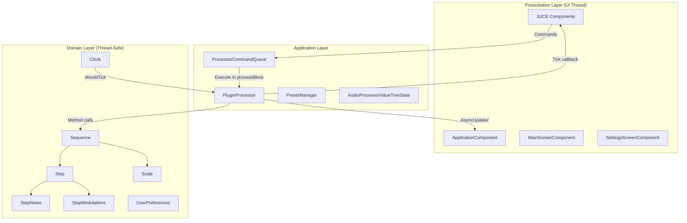
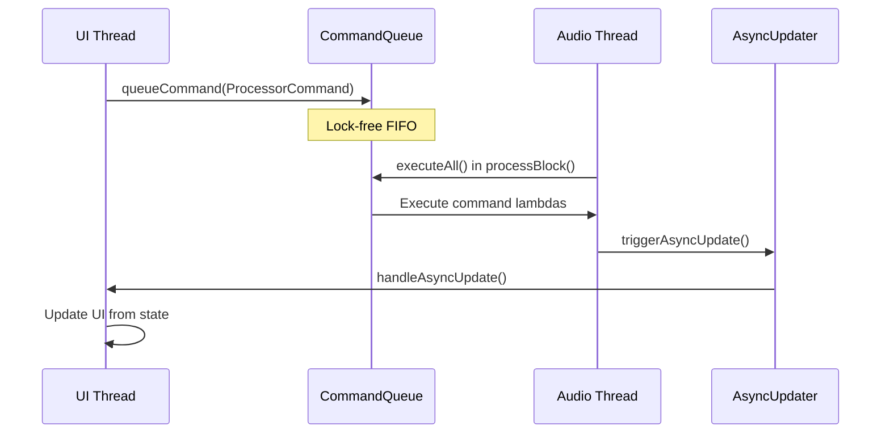
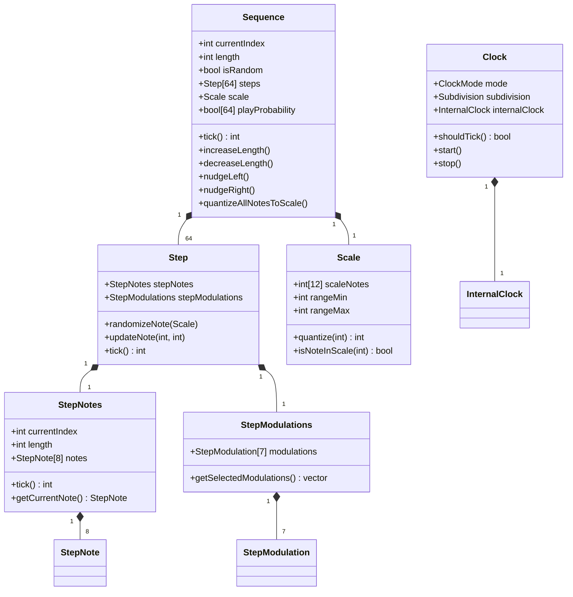
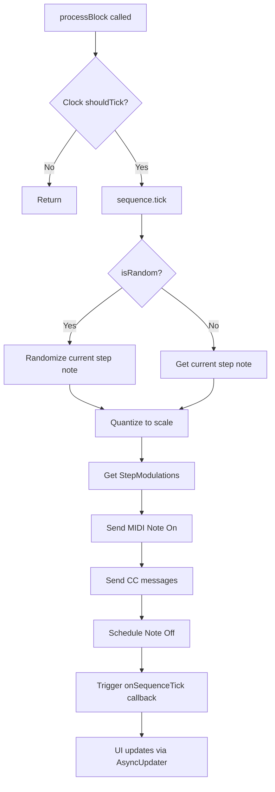
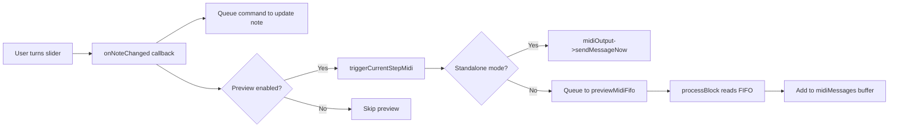
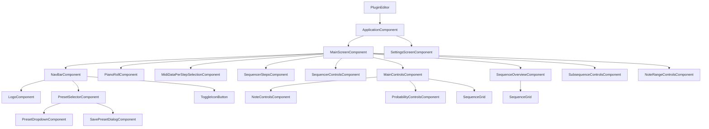
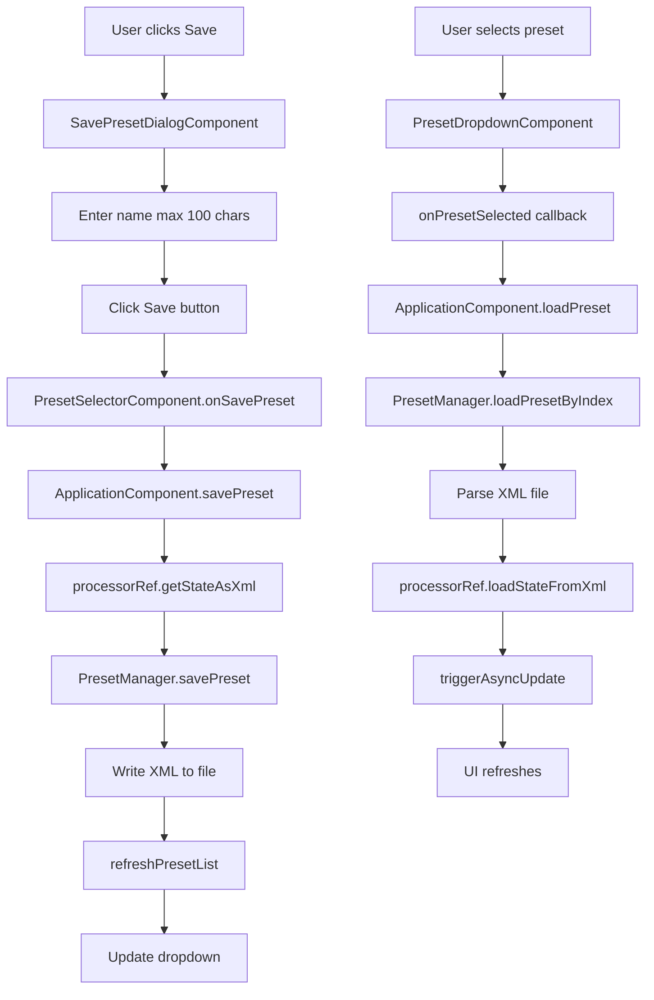

# Gambler - Comprehensive Architecture Documentation

## Overview

Gambler is a JUCE-based MIDI sequencer plugin with probabilistic and generative features, inspired by Music Thing Modular's Turing Machine. It features a 64-step sequencer with substep note cycling, scale quantization, CC/velocity modulation, and a preset management system.

**Key Characteristics:**
- Monophonic MIDI sequencer with 64 steps
- Each step can have up to 8 substep notes that cycle on each pass
- 7 modulation slots per step (velocity + 6 CC)
- Scale-based note quantization
- Dual clock modes: DAW sync or internal clock
- XML-based state persistence and preset management

---

## Architecture Overview

Gambler follows a **layered architecture** with clear separation of concerns:



### Layer Responsibilities

| Layer | Location | Responsibility |
|-------|----------|----------------|
| **Presentation** | `source/ui/` | JUCE UI components, user interaction, visual feedback |
| **Application** | `source/PluginProcessor.*` | Controller, command handling, MIDI I/O, state persistence |
| **Domain** | `source/backend/` | Pure C++ business logic, no JUCE dependencies (except XML serialization) |

---

## Thread Safety Model

Gambler uses a **command queue pattern** for thread-safe communication:



### Key Patterns

1. **UI → Audio Thread**: Commands queued via `ProcessorCommandQueue` (lock-free FIFO)
2. **Audio → UI Thread**: `AsyncUpdater` triggers UI updates after state changes
3. **Completion Callbacks**: Commands can include callbacks that run on message thread after execution

**Code Example - Queuing a Command:**
```cpp
processorRef.queueCommand(ProcessorCommand([this]() {
    // This executes on audio thread
    processorRef.getSequence().increaseLength();
}, [this]() {
    // This completion callback executes on message thread
    sequencerSteps.repaint();
}));
```

---

## Domain Model

### Class Hierarchy



### Key Domain Concepts

**Sequence**: Master orchestrator containing 64 Steps. Manages playback index, length, and random mode.

**Step**: Contains StepNotes (melodic data) and StepModulations (CC/velocity data).

**StepNotes**: Sub-sequence of up to 8 notes that cycle on each parent step trigger. Creates evolving patterns.

**Scale**: 12-note chromatic scale with on/off states. Provides quantization and note range limiting.

**Clock**: Dual-mode timing (DAW_SYNC or INTERNAL). Determines when sequencer advances.

---

## Data Flow

### Sequencer Tick Flow



### Note Preview Flow (UI Editing)



---

## File Structure

```
source/
├── PluginProcessor.cpp/h    # Application layer controller
├── PluginEditor.cpp/h       # Thin wrapper around ApplicationComponent
├── backend/                 # Domain layer (pure C++)
│   ├── Sequence.h           # Master sequencer orchestrator
│   ├── Step.h               # Individual step container
│   ├── StepNotes.h          # Note sub-sequence (8 notes)
│   ├── StepNote.h           # Single note data
│   ├── StepModulations.h    # 7 modulation slots
│   ├── StepModulation.h     # Single CC/velocity data
│   ├── Scale.h              # Scale quantization & range
│   ├── Clock.h              # Master timing
│   ├── InternalClock.h      # Internal BPM timing
│   ├── DawSync.h            # DAW playhead sync
│   ├── ClockMode.h          # Enum definitions
│   ├── ProcessorCommand.h   # Command queue pattern
│   ├── UserPreferences.h    # User settings
│   └── PresetManager.h      # Preset file management
├── ui/                      # Presentation layer
│   ├── ApplicationComponent.h    # Top-level orchestrator
│   ├── MainScreenComponent.h     # Main sequencer UI
│   ├── SettingsScreenComponent.h # Settings panel
│   ├── NavBarComponent.h         # Navigation bar
│   ├── PresetSelectorComponent.h # Preset dropdown + save
│   ├── PresetDropdownComponent.h # Custom dropdown
│   ├── SavePresetDialogComponent.h # Save dialog
│   ├── PianoRollComponent.h      # Scale selection keyboard
│   ├── SequencerStepsComponent.h # 8-step window view
│   ├── SequenceGrid.h            # 8x8 overview grid
│   ├── SequencerControlsComponent.h # Control buttons
│   ├── MainControlsComponent.h   # Note/octave/probability
│   ├── NoteControlsComponent.h   # Note & octave sliders
│   ├── NoteRangeControlsComponent.h # Min/max range
│   ├── SubsequenceControlsComponent.h # Substep controls
│   ├── MidiDataPerStepSelectionComponent.h # CC lanes
│   ├── SequenceOverviewComponent.h # Overview panel
│   ├── Icons.h                   # Centralized icon system
│   ├── ToggleIconButton.h        # Reusable toggle button
│   └── UIConstants.h             # Shared UI constants
└── data/
    └── Params.h             # APVTS parameter definitions
```

---

## UI Component Hierarchy



---

## XML Serialization

All domain objects implement `toXml()` and `fromXml()` for state persistence:

```cpp
// Sequence serialization structure
<Sequence>
    <currentIndex>0</currentIndex>
    <length>8</length>
    <isRandom>false</isRandom>
    <Scale>
        <scaleNotes>1,0,1,0,1,1,0,1,0,1,0,1</scaleNotes>
        <rangeMin>36</rangeMin>
        <rangeMax>84</rangeMax>
    </Scale>
    <PlayProbability>1,1,1,1,1,1,1,1,...</PlayProbability>
    <Step index="0">
        <StepNotes>
            <length>1</length>
            <currentIndex>0</currentIndex>
            <StepNote noteNumber="60" selected="false"/>
            ...
        </StepNotes>
        <StepModulations>
            <StepModulation type="1" ccNumber="0" value="100" selected="true"/>
            ...
        </StepModulations>
    </Step>
    ...
</Sequence>
```

**State Persistence Flow:**
1. DAW calls `getStateInformation()` → `Sequence::toXml()` + `Clock::toXml()` + `UserPreferences::toXml()`
2. DAW calls `setStateInformation()` → Parse XML → `fromXml()` on each domain object
3. Presets use same XML format, stored in `~/Library/Application Support/Gambler/Presets/`

---

## Preset Management System



---

## Constants Reference

### Sequence Constants
```cpp
static constexpr int MAX_STEPS = 64;
static constexpr int DEFAULT_LENGTH = 8;
static constexpr int MIN_LENGTH = 1;
```

### StepNotes Constants
```cpp
static constexpr int MAX_LENGTH = 8;    // Max substeps per step
static constexpr int MIN_LENGTH = 1;
static constexpr int DEFAULT_NOTE = 60; // Middle C
```

### StepModulations Constants
```cpp
static constexpr int NUM_MODULATIONS = 7;
static constexpr int DEFAULT_VELOCITY = 100;
```

### Clock Constants
```cpp
enum class ClockMode { DAW_SYNC, INTERNAL };
enum class Subdivision { QUARTER, EIGHTH, SIXTEENTH, THIRTY_SECOND };
```

### UI Constants
```cpp
// NavBar
constexpr int navBarHeight = 60;
constexpr int buttonSize = 24;

// Preset
constexpr int maxPresetNameLength = 100;
constexpr float dropdownFontSize = 12.0f;
```

---

## Key Code Patterns

### 1. Command Queue Usage
```cpp
// From UI thread - queue state modification
processorRef.queueCommand(ProcessorCommand([this]() {
    processorRef.getSequence().setLength(newLength);
}));
```

### 2. Async UI Updates
```cpp
// In ApplicationComponent
processorRef.onSequenceTick = [this]() {
    triggerAsyncUpdate();  // Safe cross-thread notification
};

void handleAsyncUpdate() override {
    mainScreen.updateFromSequence();  // Read state, update UI
}
```

### 3. MIDI Note Calculation
```cpp
int midiNote = octave * 12 + pitchClass;  // 0-127
int pitchClass = midiNote % 12;           // 0-11 (C to B)
int octave = midiNote / 12;               // 0-10
```

### 4. Scale Quantization
```cpp
int Scale::quantize(int noteNumber) const {
    // Find nearest note in scale, prefer lower when equidistant
    for (int distance = 1; distance <= 12; distance++) {
        if (isNoteInScale(noteNumber - distance)) return noteNumber - distance;
        if (isNoteInScale(noteNumber + distance)) return noteNumber + distance;
    }
    return noteNumber;
}
```

### 5. Icon System Usage
```cpp
auto path = Icons::createSaveIcon();
Icons::drawIcon(g, path, bounds, juce::Colours::white);
// Or with stroke:
Icons::strokeIcon(g, path, bounds, juce::Colours::white, 1.5f);
```

---

## Testing

Run tests with:
```bash
./cmake-build-debug/Tests --reporter rspec
```

Test coverage includes:
- Sequence tick behavior and length management
- StepNotes cycling and substep logic
- Scale quantization algorithms
- Clock timing calculations
- XML serialization round-trips

---

## Build Commands

```bash
# Configure
/Applications/CLion.app/Contents/bin/cmake/mac/aarch64/bin/cmake -B cmake-build-debug

# Build standalone
/Applications/CLion.app/Contents/bin/cmake/mac/aarch64/bin/cmake --build cmake-build-debug --target Gambler2_Standalone -j 8

# Run standalone
./cmake-build-debug/Gambler2_artefacts/Debug/Standalone/Gambler.app/Contents/MacOS/Gambler
```

---

## Detailed Component Documentation

### PluginProcessor

The central controller that bridges UI and domain layers.

**Key Members:**
- `Sequence sequence` - The 64-step sequencer
- `Clock clock` - Timing mechanism
- `ProcessorCommandQueue commandQueue` - Thread-safe command queue
- `UserPreferences userPreferences` - User settings
- `PresetManager presetManager` - Preset file management
- `APVTS apvts` - Parameter state tree

**Key Methods:**
```cpp
void processBlock(AudioBuffer<float>&, MidiBuffer&);  // Audio callback
void queueCommand(ProcessorCommand);                   // Queue UI commands
int executeCompletionCallbacks();                      // Run message-thread callbacks
void triggerCurrentStepMidi(int noteOverride = -1);   // Preview MIDI
std::unique_ptr<XmlElement> getStateAsXml();          // For preset saving
void loadStateFromXml(const XmlElement&);             // For preset loading
```

**processBlock Flow:**
1. Execute queued commands from UI
2. Process preview MIDI from FIFO
3. Check scheduled note-offs
4. Update clock (DAW sync or internal)
5. If clock ticks: advance sequence, send MIDI
6. Trigger async update for UI

### ProcessorCommandQueue

Lock-free FIFO for thread-safe UI→Audio communication.

```cpp
class ProcessorCommandQueue {
    static constexpr int QUEUE_SIZE = 128;

    bool push(ProcessorCommand);      // UI thread
    int executeAll();                  // Audio thread
    int executeCompletionCallbacks(); // Message thread
    bool hasCompletionCallbacks();
};
```

**ProcessorCommand Structure:**
```cpp
class ProcessorCommand {
    std::function<void()> command;           // Runs on audio thread
    std::function<void()> completionCallback; // Runs on message thread
};
```

### Clock System

**Clock Modes:**
- `DAW_SYNC`: Uses `DawSync` to track playhead position
- `INTERNAL`: Uses `InternalClock` with sample-accurate timing

**Subdivision Support:**
```cpp
enum class Subdivision {
    QUARTER,        // 1 tick per beat
    EIGHTH,         // 2 ticks per beat
    SIXTEENTH,      // 4 ticks per beat (default)
    THIRTY_SECOND   // 8 ticks per beat
};
```

**Clock Integration:**
```cpp
// In processBlock
if (clock.getMode() == ClockMode::DAW_SYNC) {
    auto position = getPlayHead()->getPosition();
    int pulseCount = dawSync.update(position);
    clock.updateDawSync(pulseCount);
} else {
    clock.processInternalClock(buffer.getNumSamples());
}

if (clock.shouldTick()) {
    int note = sequence.tick();
    // Send MIDI...
}
```

### Sequence

The master orchestrator managing all 64 steps.

**Key Operations:**
```cpp
int tick();                    // Advance and return note (-1 for rest)
void increaseLength();         // Add step to sequence
void decreaseLength();         // Remove step from sequence
void nudgeLeft();              // Shift all notes left
void nudgeRight();             // Shift all notes right
void quantizeAllNotesToScale(); // Re-quantize all notes
void reset();                  // Reset to step 0
```

**Random Mode:**
When `isRandom` is true, `tick()` randomizes the current step's note within the scale and range constraints.

### StepNotes - Substep Cycling

Each step can have 1-8 substep notes that cycle on each sequence pass:

```cpp
// Example: Step with 2 substeps [60, 70]
// Pass 1: plays 60
// Pass 2: plays 70
// Pass 3: plays 60 (wraps)

stepNotes.setLength(2);
stepNotes.setNote(0, 60);
stepNotes.setNote(1, 70);
```

**tick() Behavior:**
```cpp
int StepNotes::tick() {
    currentIndex = (currentIndex + 1) % length;
    // Update selection state
    for (int i = 0; i < MAX_LENGTH; i++) {
        notes[i].setSelected(i == currentIndex);
    }
    return notes[currentIndex].getNoteNumber();
}
```

### Scale Quantization

The Scale class handles note filtering and quantization:

```cpp
// Scale notes array: 1 = in scale, 0 = out of scale
// Index: C=0, Db=1, D=2, Eb=3, E=4, F=5, Gb=6, G=7, Ab=8, A=9, Bb=10, B=11

// C Major scale
scaleNotes = {1, 0, 1, 0, 1, 1, 0, 1, 0, 1, 0, 1};

// Quantization finds nearest in-scale note
// When equidistant, prefers lower note
int quantized = scale.quantize(61);  // Db → C (60)
```

### UI Component Callbacks

Components communicate via `std::function` callbacks:

```cpp
// In MainScreenComponent setup
pianoRoll.onNoteChanged = [this]() {
    Scale newScale = pianoRoll.getScale();
    processorRef.queueCommand(ProcessorCommand([this, newScale]() {
        processorRef.getSequence().getScale().setScaleNotes(newScale.getScaleNotes());
        processorRef.getSequence().quantizeAllNotesToScale();
    }));
};

// Preset callbacks
presetSelector.onPresetSelected = [this](int index) { loadPreset(index); };
presetSelector.onSavePreset = [this](const String& name) { savePreset(name); };
presetSelector.onDeletePreset = [this](int index) { deletePreset(index); };
```

---

## Common Modification Patterns

### Adding a New Domain Property

1. Add member to domain class (e.g., `Sequence.h`)
2. Add getter/setter methods
3. Add to `toXml()` and `fromXml()` for persistence
4. Wire up UI callback in `MainScreenComponent` or `ApplicationComponent`
5. Queue command for thread-safe modification

### Adding a New UI Component

1. Create component class in `source/ui/`
2. Add to parent component (usually `MainScreenComponent`)
3. Position in `resized()` method
4. Wire up callbacks to processor via command queue
5. Add to `updateFromSequence()` if it needs to reflect state

### Adding a New Icon

1. Add static method to `Icons.h`:
```cpp
static juce::Path createMyIcon() {
    juce::Path path;
    // Define path using moveTo, lineTo, etc.
    return path;
}
```
2. Use with `Icons::drawIcon()` or `Icons::strokeIcon()`

### Adding a New Setting

1. Add to `UserPreferences` struct
2. Add to `toXml()` and `fromXml()`
3. Add UI control in `SettingsScreenComponent`
4. Wire callback to modify `processorRef.getUserPreferences()`

---

## Debugging Tips

### Enable Debug Output
All components use `DBG()` macro for logging. Check console output for:
- Command execution
- MIDI events
- Preset operations
- Clock ticks

### Common Issues

**UI not updating after state change:**
- Ensure `triggerAsyncUpdate()` is called
- Check that `handleAsyncUpdate()` calls appropriate update methods

**Race conditions:**
- Always use command queue for state modifications
- Never directly modify domain objects from UI thread

**MIDI not playing:**
- Check `midiOutput` is initialized (standalone mode)
- Verify clock is running
- Check note is not -1 (rest)

---

## Note Colors (Scale)

Each chromatic note has an assigned color for visual feedback:

| Note | Color | Hex |
|------|-------|-----|
| C | Red | `0xFFFF6B6B` |
| Db | Orange | `0xFFFF9F6B` |
| D | Yellow | `0xFFFFD66B` |
| Eb | Light Yellow | `0xFFFFE66B` |
| E | Yellow-Green | `0xFFE6FF6B` |
| F | Light Green | `0xFF6BFFB4` |
| Gb | Cyan-Green | `0xFF6BFFD6` |
| G | Cyan | `0xFF6BD6FF` |
| Ab | Light Blue | `0xFF6BB4FF` |
| A | Purple | `0xFF9F6BFF` |
| Bb | Magenta | `0xFFD66BFF` |
| B | Pink | `0xFFFF6BD6` |

These colors are used in `PianoRollComponent`, `SequencerStepsComponent`, and `SequenceGrid`.

