# Gambler — Code Map

A visual map of the `source/` tree: the classes, what each one is responsible for, and
how they talk to each other. Built to be read top-down — start with the **Big Picture**,
then drill into whichever subsystem you're touching.

> **How to read this doc**
> - Each diagram's nodes carry a short key (`A1`, `B2`, …). The table right under the
>   diagram maps every key to its class, its job, and a **GitHub link** to the source.
> - Keys are grouped per diagram by a letter: `A` = overview, `B` = processor/audio core,
>   `C` = backend state & sequencing, `D` = clock/timing, `E` = MIDI learn/mapping,
>   `F` = presets & export, `G` = UI tree, `H` = threading.
> - Links point at the `main` branch, so they always show current code.
> - Arrow labels say *how* two classes relate: `owns`, `reads/writes`, `listens`,
>   `sends MIDI`, `calls`, etc.

Repo: <https://github.com/regulus33/Gambler> · Branch: `main`

---

## Table of contents

1. [Big picture](#1-big-picture)
2. [Processor & audio/MIDI core](#2-processor--audiomidi-core)
3. [Backend state & sequencing](#3-backend-state--sequencing)
4. [Clock & timing](#4-clock--timing)
5. [MIDI learn, mapping & routing](#5-midi-learn-mapping--routing)
6. [Presets & MIDI export](#6-presets--midi-export)
7. [UI component tree](#7-ui-component-tree)
8. [Threading model](#8-threading-model)
9. [The three sources of truth](#9-the-three-sources-of-truth)
10. [Breakpoint tutorial (CLion)](#10-breakpoint-tutorial-clion)

---

## 1. Big picture

Gambler is a JUCE plugin: a 64-step sequencer that reads note/scale/probability state,
advances on a clock, and emits MIDI. The plugin splits cleanly into a **processor half**
(audio thread, no GUI) and an **editor half** (message thread, all UI). State lives in
three backing stores that both halves read through domain wrappers.

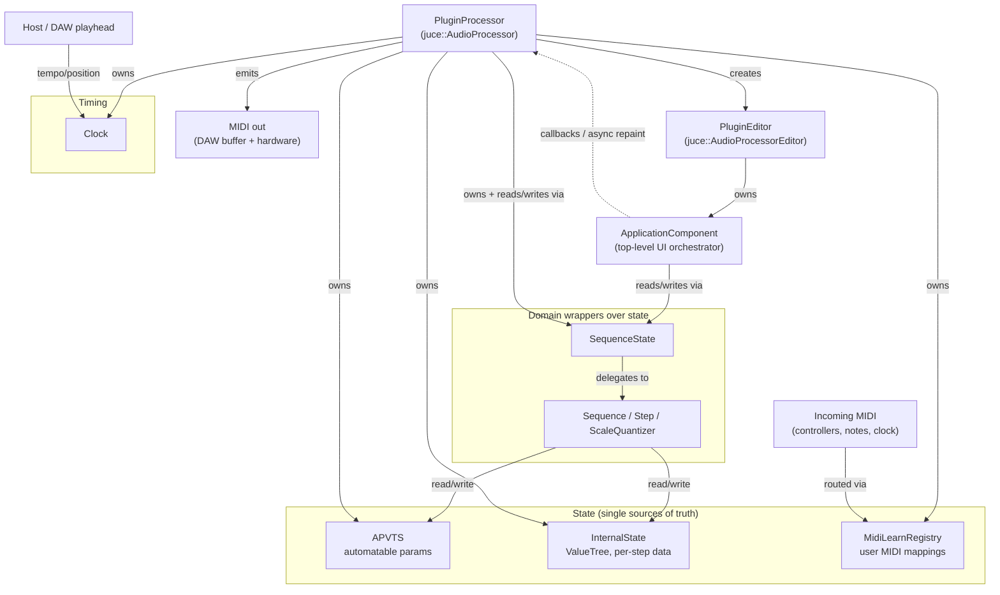

| Key | Class / thing | Role | Source |
|-----|---------------|------|--------|
| A1 | `PluginProcessor` | The plugin. Owns all state, the clock, MIDI I/O; runs `processBlock`. | [PluginProcessor.h](https://github.com/regulus33/Gambler/blob/main/source/PluginProcessor.h) · [.cpp](https://github.com/regulus33/Gambler/blob/main/source/PluginProcessor.cpp) |
| A2 | `PluginEditor` | The editor window. Scales/positions the UI, hosts the virtual keyboard, aspect-ratio + compact-mode logic. | [PluginEditor.h](https://github.com/regulus33/Gambler/blob/main/source/PluginEditor.h) · [.cpp](https://github.com/regulus33/Gambler/blob/main/source/PluginEditor.cpp) |
| A3 | `ApplicationComponent` | Top-level UI controller: owns nav/preset/screens, wires **every** processor-facing callback. | [ApplicationComponent.h](https://github.com/regulus33/Gambler/blob/main/source/ui/ApplicationComponent.h) |
| A4 | `APVTS` (`juce::AudioProcessorValueTreeState`) | Source of truth for **automatable / MIDI-mappable** params (length, scale, clock, prefs). | [Params.h](https://github.com/regulus33/Gambler/blob/main/source/data/Params.h) |
| A5 | `InternalState` | Source of truth for **non-automatable** per-step data (notes, substeps, modulations, colours, probability). | [InternalState.h](https://github.com/regulus33/Gambler/blob/main/source/backend/InternalState.h) |
| A6 | `MidiLearnRegistry` | Source of truth for user-created MIDI mappings + learn-mode state. | [MidiLearnRegistry.h](https://github.com/regulus33/Gambler/blob/main/source/backend/MidiLearnRegistry/MidiLearnRegistry.h) |
| A7 | `SequenceState` | The domain API. One façade over APVTS + InternalState the whole app calls. | [SequenceState.h](https://github.com/regulus33/Gambler/blob/main/source/backend/SequenceState.h) |
| A8 | `Sequence` / `Step` / `ScaleQuantizer` | Playback engine, per-step view, and scale/range quantization behind `SequenceState`. | [Sequence.h](https://github.com/regulus33/Gambler/blob/main/source/backend/Sequence.h) · [Step.h](https://github.com/regulus33/Gambler/blob/main/source/backend/Step/Step.h) · [ScaleQuantizer.h](https://github.com/regulus33/Gambler/blob/main/source/backend/ScaleQuantizer.h) |
| A9 | `Clock` | Decides *when* to advance a step (internal / DAW / external MIDI clock). | [Clock.h](https://github.com/regulus33/Gambler/blob/main/source/backend/Clock.h) |
| A10 | MIDI output | Notes/CCs written to the DAW `MidiBuffer` and, in standalone, to hardware. | *(processBlock)* |
| A11 | Host playhead | `juce::AudioPlayHead` — tempo & PPQ position for DAW sync. | *(JUCE)* |
| A12 | Incoming MIDI | Controllers/notes/transport clock, routed through the learn registry. | *(processBlock)* |

---

## 2. Processor & audio/MIDI core

`PluginProcessor::processBlock` is the heartbeat. It drains the virtual keyboard, routes
incoming MIDI, advances the clock, and — for every clock pulse this block — ticks the
sequencer and emits notes. `processBlock` was refactored into small named helpers; the
diagram shows the call order.

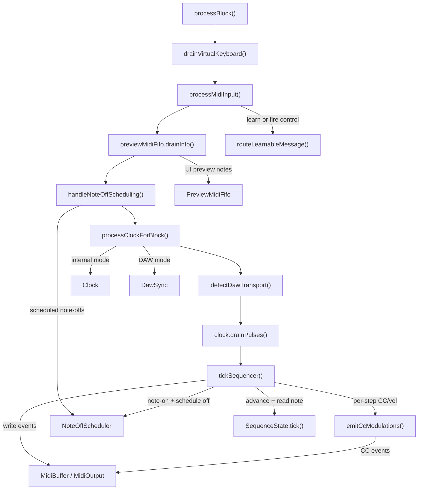

| Key | Method / class | Role | Source |
|-----|----------------|------|--------|
| B1 | `processBlock` | Per-block entry on the audio thread; orchestrates the pipeline below. | [PluginProcessor.cpp#L179](https://github.com/regulus33/Gambler/blob/main/source/PluginProcessor.cpp#L179) |
| B2 | `drainVirtualKeyboard` | Pulls computer-keyboard notes (standalone) into the MIDI buffer. | [PluginProcessor.cpp#L209](https://github.com/regulus33/Gambler/blob/main/source/PluginProcessor.cpp#L209) |
| B3 | `processMidiInput` | Iterates incoming MIDI: transport → CC → note, dispatching each. | [PluginProcessor.cpp#L878](https://github.com/regulus33/Gambler/blob/main/source/PluginProcessor.cpp#L878) |
| B4 | `previewMidiFifo.drainInto` | Injects UI-audition notes queued from the message thread. | [PreviewMidiFifo.h](https://github.com/regulus33/Gambler/blob/main/source/backend/PreviewMidiFifo.h) |
| B5 | `handleNoteOffScheduling` | Emits any sample-accurate note-off that's due this block. | [PluginProcessor.cpp#L213](https://github.com/regulus33/Gambler/blob/main/source/PluginProcessor.cpp#L213) |
| B6 | `processClockForBlock` | Feeds DAW playhead (or internal timer) into the clock as pulses. | [PluginProcessor.cpp#L223](https://github.com/regulus33/Gambler/blob/main/source/PluginProcessor.cpp#L223) |
| B7 | `detectDawTransport` | Auto-resumes the sequencer when the DAW starts playing. | [PluginProcessor.cpp#L248](https://github.com/regulus33/Gambler/blob/main/source/PluginProcessor.cpp#L248) |
| B8 | `clock.drainPulses` | Returns the sub-block offsets where a step should fire. | [Clock.h#L230](https://github.com/regulus33/Gambler/blob/main/source/backend/Clock.h#L230) |
| B9 | `tickSequencer` | For one pulse: advance the sequence, emit note-on + mods, schedule note-off, fire UI tick. | [PluginProcessor.cpp#L300](https://github.com/regulus33/Gambler/blob/main/source/PluginProcessor.cpp#L300) |
| B10 | `emitCcModulations` | Writes the step's selected CC modulations; captures velocity. | [PluginProcessor.cpp#L283](https://github.com/regulus33/Gambler/blob/main/source/PluginProcessor.cpp#L283) |
| B11 | `NoteOffScheduler` | Tracks the last note + a scheduled note-off sample; handles immediate/preview/stop offs. | [NoteOffScheduler.h](https://github.com/regulus33/Gambler/blob/main/source/backend/NoteOffScheduler.h) |
| B12 | `PreviewMidiFifo` | Lock-free SPSC ring buffer, message→audio thread, for preview notes. | [PreviewMidiFifo.h](https://github.com/regulus33/Gambler/blob/main/source/backend/PreviewMidiFifo.h) |
| B13 | `Clock` | Timing state machine (see §4). | [Clock.h](https://github.com/regulus33/Gambler/blob/main/source/backend/Clock.h) |
| B14 | `DawSync` | Converts playhead PPQ into sub-block pulse offsets; handles loop/scrub jumps. | [DawSync.h](https://github.com/regulus33/Gambler/blob/main/source/backend/DawSync.h) |
| B15 | `SequenceState::tick` | Advances the playhead and returns the quantized note (or −1 rest). | [SequenceState.h#L325](https://github.com/regulus33/Gambler/blob/main/source/backend/SequenceState.h#L325) |
| B16 | `MidiBuffer` / `MidiOutput` | DAW buffer + optional standalone hardware output. | *(JUCE)* |

**Also on the processor** — the parameter-change side. APVTS calls
`PluginProcessor::parameterChanged`, which fans out to category handlers that mutate state
or the clock. This is how a UI click *or* a MIDI controller *or* DAW automation all end up
doing the same thing:

| Key | Method | Role | Source |
|-----|--------|------|--------|
| B17 | `parameterChanged` | APVTS listener entry; dispatches to the handlers below. | [PluginProcessor.cpp#L460](https://github.com/regulus33/Gambler/blob/main/source/PluginProcessor.cpp#L460) |
| B18 | `handlePrimaryRowParam` / `handleSecondaryRowParam` | Roll, length, nudge, duplicate, clear, randomize, shuffle. | [PluginProcessor.cpp#L470](https://github.com/regulus33/Gambler/blob/main/source/PluginProcessor.cpp#L470) |
| B19 | `handleClockParam` | Applies clock mode / BPM / subdivision param changes to `Clock`. | [PluginProcessor.cpp#L613](https://github.com/regulus33/Gambler/blob/main/source/PluginProcessor.cpp#L613) |
| B20 | `togglePlayPause` / `stopSequencer` | Playback state machine (`Stopped`/`Playing`/`Paused`). | [PluginProcessor.cpp#L766](https://github.com/regulus33/Gambler/blob/main/source/PluginProcessor.cpp#L766) |

---

## 3. Backend state & sequencing

This is the domain model. `SequenceState` is a thin façade; the real work is split across
`Sequence` (playback/mutation), `Step` (a zero-alloc view onto one step), `ScaleQuantizer`
(scale + range logic), and the two backing stores. Note the deliberate split: **automatable
params live in APVTS; bulky per-step data lives in InternalState.**

```mermaid
flowchart TD
    C1["SequenceState<br/>(domain façade)"]
    C2["Sequence<br/>(playback + mutation engine)"]
    C3["Step<br/>(per-step view, no data)"]
    C4["ScaleQuantizer<br/>(scale/range quantize + bake)"]
    C5["Scale<br/>(window math, note names)"]
    C6["StepModulationData<br/>(CC/velocity struct)"]
    C7["EdenGrowthPattern<br/>(probability scatter)"]
    C8["Grid<br/>(square grid helper)"]

    C9["APVTS<br/>(automatable)"]
    C10["InternalState<br/>(ValueTree per-step data)"]

    C1 -->|owns| C4
    C1 -->|owns| C2
    C1 -->|step(i)| C3
    C2 -->|step(i)| C3
    C2 -->|owns| C7
    C7 -->|uses| C8
    C2 -->|quantize/bake| C4
    C4 -->|window math| C5
    C3 -->|reads/writes| C10
    C3 -->|selectedModulations| C6
    C1 -->|length, flags, prefs| C9
    C2 -->|length, isRandom| C9
    C4 -->|scale notes, window, destructive| C9
    C1 -->|notes, substeps, colours| C10
    C2 -->|pending note writes SPSC| C10
```

| Key | Class | Role | Source |
|-----|-------|------|--------|
| C1 | `SequenceState` | Domain API over APVTS + InternalState. Everything (UI + processor) reads/writes state through this. | [SequenceState.h](https://github.com/regulus33/Gambler/blob/main/source/backend/SequenceState.h) |
| C2 | `Sequence` | The engine: `tick()` (advance + play), nudge/rotate, randomize, reset, and the audio→message pending-note ring buffer. | [Sequence.h](https://github.com/regulus33/Gambler/blob/main/source/backend/Sequence.h) |
| C3 | `Step` | Lightweight view = `InternalState&` + index. Substep notes, substep cursor, modulations. No owned data. | [Step.h](https://github.com/regulus33/Gambler/blob/main/source/backend/Step/Step.h) |
| C4 | `ScaleQuantizer` | The single authority for `quantize()` (on-the-fly) and `bake()` (destructive), reading scale/range/destructive flags from APVTS. | [ScaleQuantizer.h](https://github.com/regulus33/Gambler/blob/main/source/backend/ScaleQuantizer.h) |
| C5 | `Scale` | Pure helpers: window offset/size ⇄ MIDI min/max, note-name table. Quantization deliberately *not* here. | [Scale.h](https://github.com/regulus33/Gambler/blob/main/source/backend/Scale.h) |
| C6 | `StepModulationData` | Plain struct: one modulation slot (type = CC or Velocity, cc#, value, selected). | [StepModulationData.h](https://github.com/regulus33/Gambler/blob/main/source/backend/Step/StepModulationData.h) |
| C7 | `EdenGrowthPattern` | Stateful, monotonic random-scatter pattern that drives the probability gauge cells. | [EdenGrowthPattern.h](https://github.com/regulus33/Gambler/blob/main/source/algorithms/probability/EdenGrowthPattern.h) |
| C8 | `Grid` | Square bounded grid (dims 2/4/8) with neighbour math, used by the pattern. | [Grid.h](https://github.com/regulus33/Gambler/blob/main/source/algorithms/probability/Grid.h) |
| C9 | `APVTS` | Backing store #1: automatable params (see [Params.h](https://github.com/regulus33/Gambler/blob/main/source/data/Params.h)). | [Params.h](https://github.com/regulus33/Gambler/blob/main/source/data/Params.h) |
| C10 | `InternalState` | Backing store #2: ValueTree of per-step notes/substeps/mods/colours/probability + listener support. | [InternalState.h](https://github.com/regulus33/Gambler/blob/main/source/backend/InternalState.h) · [.cpp](https://github.com/regulus33/Gambler/blob/main/source/backend/InternalState.cpp) |
| — | `ModulationType` | Enum `{ CC, Velocity }`. | [ModulationType.h](https://github.com/regulus33/Gambler/blob/main/source/backend/ModulationType.h) |

> **Key detail — audio-safe note writes.** When Roll (random mode) generates a note on the
> audio thread, `Sequence` doesn't write to the ValueTree directly (not audio-safe). It
> pushes onto a lock-free SPSC ring (`queueNoteWrite`), and the UI drains it via
> `applyPendingNoteWrites()` on the message thread. See [Sequence.h#L314](https://github.com/regulus33/Gambler/blob/main/source/backend/Sequence.h#L314).

---

## 4. Clock & timing

`Clock` is a mode-switched façade over three timing sources. It never touches the sequencer
directly — it just produces a queue of sub-block pulse offsets that `processBlock` drains.

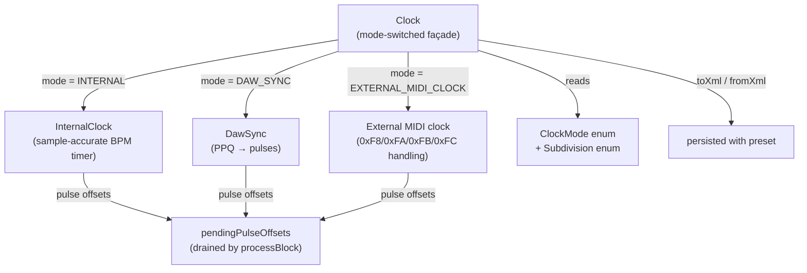

| Key | Class / thing | Role | Source |
|-----|---------------|------|--------|
| D1 | `Clock` | Chooses the timing source, exposes `drainPulses()`, `calculateSamplesPerStep()`, XML persistence, and MIDI-clock-out accumulation. | [Clock.h](https://github.com/regulus33/Gambler/blob/main/source/backend/Clock.h) |
| D2 | `InternalClock` | Pure BPM timer: accumulates samples, emits sub-block pulse offsets, carries fractional residue for exact timing. | [InternalClock.h](https://github.com/regulus33/Gambler/blob/main/source/backend/InternalClock.h) |
| D3 | `DawSync` | Reads `AudioPlayHead` PPQ, converts to pulses, detects loop-back / scrub jumps and re-anchors without spurious pulses. | [DawSync.h](https://github.com/regulus33/Gambler/blob/main/source/backend/DawSync.h) |
| D4 | External MIDI clock | Counts 24-PPQN pulses, fires a step every N (per subdivision); handles Start/Continue/Stop. | [Clock.h#L245](https://github.com/regulus33/Gambler/blob/main/source/backend/Clock.h#L245) |
| D5 | `ClockMode` / `Subdivision` | Enums + `getPulsesPerQuarterNote()` helper. | [ClockMode.h](https://github.com/regulus33/Gambler/blob/main/source/backend/ClockMode.h) |
| D6 | `pendingPulseOffsets` | The queue of "fire a step at this sub-block sample" offsets. | [Clock.h#L400](https://github.com/regulus33/Gambler/blob/main/source/backend/Clock.h#L400) |
| D7 | Clock XML | Mode/BPM/subdivision saved into the preset blob. | [Clock.h#L340](https://github.com/regulus33/Gambler/blob/main/source/backend/Clock.h#L340) |

---

## 5. MIDI learn, mapping & routing

Incoming MIDI (from a controller) is dispatched by `PluginProcessor`. In **learn mode** the
message is captured as a new mapping; otherwise it's resolved to a `MidiControlId` and
executed. Notes always resolve to *something* (a user mapping, or the default scale key for
`note % 12`); CCs only fire if explicitly mapped.

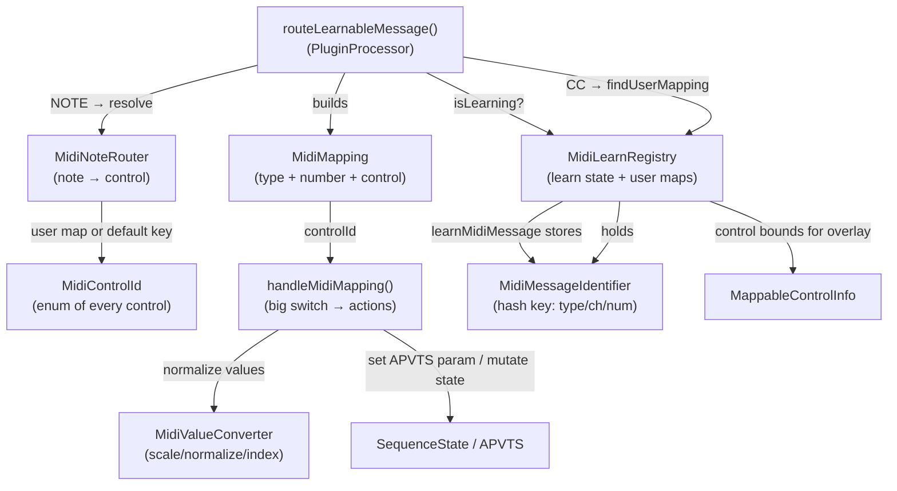

| Key | Class / method | Role | Source |
|-----|----------------|------|--------|
| E1 | `routeLearnableMessage` | Shared entry for CC + Note: learn-or-route, then dispatch. | [PluginProcessor.cpp#L946](https://github.com/regulus33/Gambler/blob/main/source/PluginProcessor.cpp#L946) |
| E2 | `MidiLearnRegistry` | Learn-mode flag, `userMappings` (msg→control) and `controlToMidi` (control→msg), XML persistence, control-bounds registration. | [MidiLearnRegistry.h](https://github.com/regulus33/Gambler/blob/main/source/backend/MidiLearnRegistry/MidiLearnRegistry.h) |
| E3 | `MidiNoteRouter` | Resolves a note to a control: user mapping first, else `SCALE_NOTE_C + (note%12)`. | [MidiNoteRouter.h](https://github.com/regulus33/Gambler/blob/main/source/backend/MidiNoteRouter.h) |
| E4 | `MidiControlId` | Enum naming every mappable control (scale keys, steps, transport, sliders, …) + `getMidiControlName`. | [MidiControlId.h](https://github.com/regulus33/Gambler/blob/main/source/backend/MidiMapping/MidiControlId.h) |
| E5 | `MidiMapping` | Struct tying a message type + number to a control, with min/max/invert. | [MidiMapping.h](https://github.com/regulus33/Gambler/blob/main/source/backend/MidiMapping/MidiMapping.h) |
| E6 | `MidiValueConverter` | 0–127 → normalized / scaled / boolean / discrete-index conversions. | [MidiValueConverter.h](https://github.com/regulus33/Gambler/blob/main/source/backend/MidiMapping/MidiValueConverter.h) |
| E7 | `handleMidiMapping` | The big `switch(controlId)` that turns a mapped message into an actual action. | [PluginProcessor.cpp#L1151](https://github.com/regulus33/Gambler/blob/main/source/PluginProcessor.cpp#L1151) |
| E8 | `MidiMessageIdentifier` | Hashable `{type, channel, number}` used as the mapping key. | [MidiMessageIdentifier.h](https://github.com/regulus33/Gambler/blob/main/source/backend/MidiLearnRegistry/MidiMessageIdentifier.h) |
| E10 | `MappableControlInfo` | A control's screen bounds + display name, for painting learn overlays. | [MappableControlInfo.h](https://github.com/regulus33/Gambler/blob/main/source/backend/MidiLearnRegistry/MappableControlInfo.h) |
| — | `MidiMessageType` | Enum `{ CC, NOTE }`. | [MidiMessageType.h](https://github.com/regulus33/Gambler/blob/main/source/backend/MidiMapping/MidiMessageType.h) |

> On the UI side, every mappable widget holds a `MidiLearnRegistry*` and, while learning,
> a click calls `setLearningControl(id)` and paints a highlight via
> [`MidiLearnOverlayPainter`](https://github.com/regulus33/Gambler/blob/main/source/ui/MidiLearnOverlayPainter.h). The next
> incoming message is then bound to that control.

---

## 6. Presets & MIDI export

State is serialized to a single `GamblerState` XML blob (APVTS + InternalState + Clock +
MIDI mappings). `PresetManager` persists those blobs as files; `MidiExporter` renders the
live sequence to a standard MIDI file.

```mermaid
flowchart TD
    F1["PluginProcessor<br/>getStateAsXml / loadStateFromXml"]
    F2["PresetManager<br/>(XML files on disk)"]
    F3["MidiExporter<br/>(SequenceState → .mid)"]
    F4["ApplicationComponent<br/>(preset UI wiring)"]
    F5["PresetSelectorComponent<br/>(dropdown + cycle + save)"]

    F4 -->|save/load/delete/cycle| F2
    F4 -->|getStateAsXml| F1
    F2 -->|loadPresetByIndex XML| F1
    F4 -->|export click/drag| F3
    F3 -->|reads| F6["SequenceState"]
    F5 -.->|callbacks| F4
    F1 -->|getStateInformation<br/>(host preset)| F7["DAW"]
```

| Key | Class / method | Role | Source |
|-----|----------------|------|--------|
| F1 | `getStateAsXml` / `loadStateFromXml` / `getStateInformation` | Serialize/restore the full `GamblerState` blob (APVTS + InternalState + Clock + mappings). | [PluginProcessor.cpp#L819](https://github.com/regulus33/Gambler/blob/main/source/PluginProcessor.cpp#L819) |
| F2 | `PresetManager` | Scans/saves/loads/deletes preset XML files in the app-data `Presets/` dir; tracks current name. | [PresetManager.h](https://github.com/regulus33/Gambler/blob/main/source/backend/PresetManager.h) |
| F3 | `MidiExporter` | Renders one clean loop of the sequence (unrolled to `lcm` of substep counts) to a Type-0 MIDI file. | [MidiExporter.h](https://github.com/regulus33/Gambler/blob/main/source/backend/MidiExporter.h) |
| F4 | `ApplicationComponent` (preset section) | Wires save/load/delete/cycle + export; also the MIDI-triggered preset cycling callbacks. | [ApplicationComponent.h#L666](https://github.com/regulus33/Gambler/blob/main/source/ui/ApplicationComponent.h#L666) |
| F5 | `PresetSelectorComponent` | The dropdown + cycle buttons + save button in the top strip. | [PresetSelectorComponent.h](https://github.com/regulus33/Gambler/blob/main/source/ui/PresetSelectorComponent/PresetSelectorComponent.h) |

---

## 7. UI component tree

The UI is a containment tree rooted at `ApplicationComponent`. Most leaf widgets extend
**`StateListenerComponent`** — the base class that subscribes to APVTS/InternalState and
coalesces changes into a single message-thread `onStateChanged()`. This is why the UI stays
in sync no matter whether a change came from a click, a MIDI controller, or automation.

### 7a. Containment

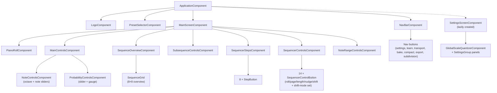

| Key | Class | Role | Source |
|-----|-------|------|--------|
| G1 | `ApplicationComponent` | Root UI controller; owns the strip + screens and all callback wiring. | [ApplicationComponent.h](https://github.com/regulus33/Gambler/blob/main/source/ui/ApplicationComponent.h) |
| G2 | `LogoComponent` | The logo in the top-left strip. | [LogoComponent.h](https://github.com/regulus33/Gambler/blob/main/source/ui/LogoComponent.h) |
| G3 | `PresetSelectorComponent` | Preset dropdown + cycle/save (top-right). | [PresetSelectorComponent.h](https://github.com/regulus33/Gambler/blob/main/source/ui/PresetSelectorComponent/PresetSelectorComponent.h) |
| G4 | `NavBarComponent` | Shared top bar: settings, MIDI-learn, transport, bake, compact-view, export, subdivision. | [NavBarComponent.h](https://github.com/regulus33/Gambler/blob/main/source/ui/NavBarComponent/NavBarComponent.h) |
| G5 | `MainScreenComponent` | The sequencer screen; lays out the 7 panels, handles compact/row-swap modes, pushes state → widgets. | [MainScreenComponent.h](https://github.com/regulus33/Gambler/blob/main/source/ui/MainScreenComponent.h) |
| G6 | `SettingsScreenComponent` | Full-screen 2×2 settings grid (clock, scale quantizer, playback/MIDI, colours). | [SettingsScreenComponent.h](https://github.com/regulus33/Gambler/blob/main/source/ui/SettingsScreenComponent/SettingsScreenComponent.h) |
| G7 | `PianoRollComponent` | 12 SVG keys → edits the global scale; animates active-note + colour fades. | [PianoRollComponent.h](https://github.com/regulus33/Gambler/blob/main/source/ui/PianoRollComponent/PianoRollComponent.h) |
| G8 | `MainControlsComponent` | Container for note/octave + probability controls. | [MainControlsComponent.h](https://github.com/regulus33/Gambler/blob/main/source/ui/MainControlsComponent.h) |
| G9 | `SequenceOverviewComponent` | Wraps the 8×8 `SequenceGrid` and updates it from state. | [SequenceOverviewComponent.h](https://github.com/regulus33/Gambler/blob/main/source/ui/SequenceOverviewComponent.h) |
| G10 | `SubsequenceControlsComponent` | Substep bar (8) + `−`/`+`; edits the selected step's substeps. | [SubsequenceControlsComponent.h](https://github.com/regulus33/Gambler/blob/main/source/ui/SubsequencerComponent/SubsequenceControlsComponent.h) |
| G11 | `SequencerStepsComponent` | The 8-step window; also hosts the drag-to-set-length gesture. | [SequencerStepsComponent.h](https://github.com/regulus33/Gambler/blob/main/source/ui/SequencerStepsComponent.h) |
| G12 | `SequencerControlsComponent` | Row of 8 control buttons; swaps 6 of them in Shift mode. | [SequencerControlsComponent.h](https://github.com/regulus33/Gambler/blob/main/source/ui/SequencerControlsComponent.h) |
| G13 | `NoteRangeControlsComponent` | Window offset/size knobs + range gauge (right of the sequencer). | [NoteRangeControlsComponent.h](https://github.com/regulus33/Gambler/blob/main/source/ui/NoteRangeControlsComponent/NoteRangeControlsComponent.h) |
| G14 | `NoteControlsComponent` | Bordered container for the octave + note `NotchedSlider`s. | [NoteControlsComponent.h](https://github.com/regulus33/Gambler/blob/main/source/ui/NoteControlsComponent.h) |
| G15 | `ProbabilityControlsComponent` | Probability slider + `ProbabilityGauge` + dice/divide buttons. | [ProbabilityControlsComponent.h](https://github.com/regulus33/Gambler/blob/main/source/ui/ProbabilityControlsComponent.h) · [.cpp](https://github.com/regulus33/Gambler/blob/main/source/ui/ProbabilityControlsComponent.cpp) |
| G16 | `SequenceGrid` | 8×8 grid: colour per step, current/selected borders, drag-to-length, VBlank fades. | [SequenceGrid.h](https://github.com/regulus33/Gambler/blob/main/source/ui/SequenceGrid/SequenceGrid.h) |
| G17 | `StepButton` | One of 8 window steps; paints note/rest/current/selected, auditions on release, MIDI-learnable. | [StepButton.h](https://github.com/regulus33/Gambler/blob/main/source/ui/buttons/StepButton.h) |
| G18 | `SequencerControlButton` | Base for the control-row buttons: click sets an APVTS param, visual state is APVTS-driven. | [SequencerControlButton.h](https://github.com/regulus33/Gambler/blob/main/source/ui/buttons/SequencerControlButton.h) |
| G19 | Nav buttons | `ToggleIconButton`, `ScaleLatchButton`, `DestructiveToggleButton`, `ExportButton`, `SubdivisionSlider`. | [source/ui/](https://github.com/regulus33/Gambler/tree/main/source/ui) |
| G20 | `GlobalScaleQuantizerComponent` / `SettingsGroup` | Settings panels. | [GlobalScaleQuantizerComponent.h](https://github.com/regulus33/Gambler/blob/main/source/ui/GlobalScaleQuantizerComponent.h) |

### 7b. How a widget stays in sync (the observer pattern)

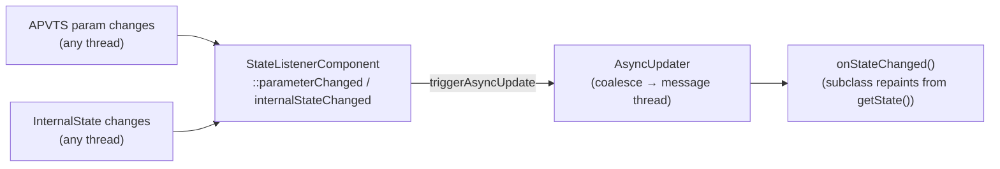

| Key | Class / method | Role | Source |
|-----|----------------|------|--------|
| H3 | `StateListenerComponent` | Base class: subscribe to params/InternalState; forwards changes to an `AsyncUpdater`. | [StateListenerComponent.h](https://github.com/regulus33/Gambler/blob/main/source/ui/StateListenerComponent.h) |
| H5 | `onStateChanged()` | Pure-virtual each widget overrides to repaint from current state on the message thread. | [StateListenerComponent.h#L165](https://github.com/regulus33/Gambler/blob/main/source/ui/StateListenerComponent.h#L165) |

> `ApplicationComponent` is itself an `AsyncUpdater`: the processor's `onSequenceTick`
> callback (fired from the audio thread every step) calls `triggerAsyncUpdate()`, which on
> the message thread drains pending note writes and calls `mainScreen.updateFromSequence()`
> to refresh every panel. See [ApplicationComponent.h#L292](https://github.com/regulus33/Gambler/blob/main/source/ui/ApplicationComponent.h#L292).

---

## 8. Threading model

Two threads, three hand-off mechanisms. Getting this right is most of what makes the code
tricky.

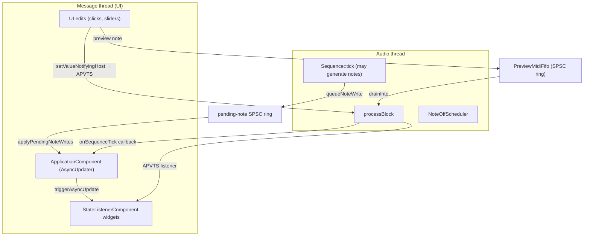

| Key | Mechanism | Direction | Why | Source |
|-----|-----------|-----------|-----|--------|
| T7 | `PreviewMidiFifo` | message → audio | Send UI-audition notes into `processBlock` without locks. | [PreviewMidiFifo.h](https://github.com/regulus33/Gambler/blob/main/source/backend/PreviewMidiFifo.h) |
| T8 | pending-note ring | audio → message | Roll-mode generated notes get written to the ValueTree off the audio thread. | [Sequence.h#L382](https://github.com/regulus33/Gambler/blob/main/source/backend/Sequence.h#L382) |
| T5 | `AsyncUpdater` + callbacks | audio → message | `onSequenceTick`/`onNoteOff`/`onMidiLearned` coalesce into batched UI refreshes. | [ApplicationComponent.h#L203](https://github.com/regulus33/Gambler/blob/main/source/ui/ApplicationComponent.h#L203) |
| T4 | APVTS / InternalState listeners | any → message | Widgets self-refresh from param/state changes regardless of origin. | [StateListenerComponent.h](https://github.com/regulus33/Gambler/blob/main/source/ui/StateListenerComponent.h) |

---

## 9. The three sources of truth

If you remember nothing else, remember where each kind of state lives — most "why isn't
this saving / updating?" questions resolve here.

| Store | What lives here | Automatable? | Saved in preset? | Accessed via |
|-------|-----------------|:---:|:---:|--------------|
| **APVTS** | length, selected step, roll/shift flags, scale notes, scale window, clock mode/BPM/subdivision, MIDI channel, prefs, transport/destructive triggers | ✅ | ✅ | [`SequenceState`](https://github.com/regulus33/Gambler/blob/main/source/backend/SequenceState.h) / [`ScaleQuantizer`](https://github.com/regulus33/Gambler/blob/main/source/backend/ScaleQuantizer.h) |
| **InternalState** | 64×8 step notes, substep counts/cursors, 64×7 modulations, note colours, play-probability array, view-window start | ❌ | ✅ | [`Step`](https://github.com/regulus33/Gambler/blob/main/source/backend/Step/Step.h) via [`SequenceState`](https://github.com/regulus33/Gambler/blob/main/source/backend/SequenceState.h) |
| **MidiLearnRegistry** | user MIDI→control mappings, learn-mode flag | ❌ | ✅ | [`MidiLearnRegistry`](https://github.com/regulus33/Gambler/blob/main/source/backend/MidiLearnRegistry/MidiLearnRegistry.h) directly |

All three are serialized together into the `GamblerState` XML blob by
[`getStateAsXml`](https://github.com/regulus33/Gambler/blob/main/source/PluginProcessor.cpp#L819) and restored by
[`loadStateFromXml`](https://github.com/regulus33/Gambler/blob/main/source/PluginProcessor.cpp#L840) /
[`setStateInformation`](https://github.com/regulus33/Gambler/blob/main/source/PluginProcessor.cpp#L387).

---

## 10. Breakpoint tutorial (CLion)

A guided, hands-on tour. You'll **run the standalone app, interact with it, and set
breakpoints** at the exact points where a UI gesture becomes data and crosses into the audio
thread (and back). Each "journey" is one user action traced end-to-end, with a diagram and a
breakpoint table. Do them in order — they build on each other.

Every breakpoint has a key (`A1`, `B2`, …) that maps to a table row with a **clickable
`file:line`** so you can jump straight to the gutter line in CLion.

### 10.0 Setup & a 60-second CLion primer

**Run it:**
1. Load the CMake project in CLion. Pick the **`Gambler2_Standalone`** run configuration,
   build type **Debug** (so nothing is optimized away).
2. Run with the debugger (the bug icon / `Debug`). The standalone opens your default audio
   device automatically — you need an active output device or `processBlock` is never called.
3. There is **no built-in synth on `main`**, so "notes" are MIDI messages, not sound. You're
   watching *data*, not listening. The app also prints `DBG(...)` lines to the CLion **Console**
   — keep it visible; it narrates a lot of what you're about to breakpoint.

**Two threads, always.** Everything in this app is a dance between:
- the **message thread** (a.k.a. UI thread) — clicks, sliders, repaints, APVTS writes; and
- the **audio thread** — `processBlock`, the clock, note emission.

In CLion's **Debug** tool window, the **Frames** dropdown has a thread selector. You can tell
which thread you stopped on by the bottom of the stack: the message thread bottoms out in
JUCE's message loop, the audio thread in the audio device callback (`processBlock` near the
top).

**Four CLion tricks you'll use constantly:**

| Trick | How | Why it matters here |
|-------|-----|---------------------|
| **Conditional breakpoint** | Right-click the breakpoint dot → **Condition** → type a C++ expression | `processBlock` fires ~344×/sec at 120 BPM/16ths. Condition on `note >= 0` (etc.) so you stop only when something interesting happens. |
| **Non-suspending log point** | Right-click dot → uncheck **Suspend**, check **Evaluate and log** → enter an expression | Print a value from the **audio thread** *without* freezing it (freezing the audio thread glitches/stops the stream). |
| **Evaluate Expression** | `⌥F8` (macOS) / `Alt+F8` | Inspect `state.getCurrentIndex()`, `note`, `mapping.controlId`, etc. live in any frame. |
| **Suspend: Thread vs All** | Right-click dot → **Suspend: Thread** | Stopping the audio thread with **All** also freezes the UI. **Thread** keeps the UI painting so you can still see the app while parked in `processBlock`. |

> ⚠️ **Audio-thread breakpoints stall audio.** Any *suspending* breakpoint inside
> `processBlock` (or anything it calls) halts the audio callback while you're parked — the
> stream underruns and, in a DAW, transport may drop. In standalone that's harmless (you're
> just debugging), but prefer **log points** on hot audio-thread lines and save suspending
> breakpoints for a single, condition-gated hit.

### 10.1 The journey map

The six journeys below, and which thread each one lives on. Follow the numbers.

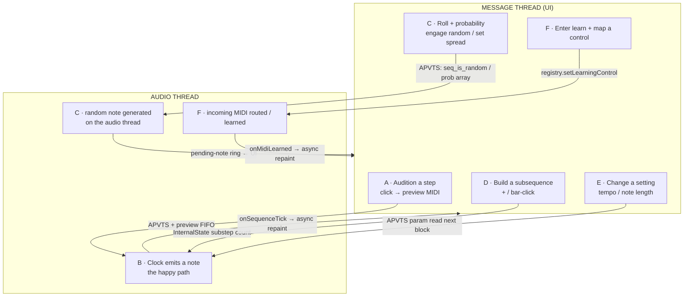

| Journey | What you'll learn | Threads crossed |
|---------|-------------------|-----------------|
| [A](#102-journey-a--audition-a-step-ui--audio) | How a click becomes a preview note and (in plugin mode) crosses the FIFO. | UI → audio |
| [B](#103-journey-b--the-clock-emits-a-note-the-happy-path) | The core playback loop: clock → tick → note-on → scheduled note-off → UI tick. | audio → UI |
| [C](#104-journey-c--roll--probability-random-notes-spread-out) | Random note generation on the audio thread + how probability "spreads" which steps fire. | UI → audio → UI |
| [D](#105-journey-d--building-a-subsequence) | Editing per-step substeps in `InternalState` and how playback walks them. | UI → audio |
| [E](#106-journey-e--a-setting-takes-effect) | How a settings widget mutates an APVTS param that the audio thread reads next block. | UI → audio |
| [F](#107-journey-f--midi-learn--incoming-midi) | Learn-mode capture and how incoming controller/note MIDI is routed to actions. | audio → UI |

---

### 10.2 Journey A — Audition a step (UI → audio)

**Do this:** single-click any step button in the bottom sequencer row. That step is selected
for editing and its note is previewed.

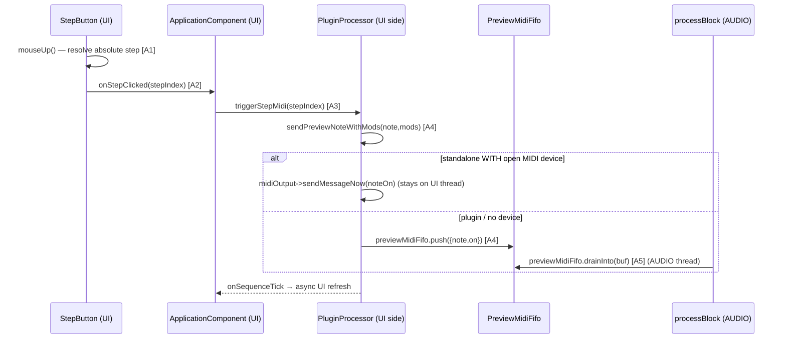

| Key | Where | Set the breakpoint to see… | `file:line` |
|-----|-------|----------------------------|-------------|
| A1 | `StepButton::mouseUp` | The click resolving to an **absolute** step index (`windowStart + localIndex`); a drag-off is rejected here. Inspect `getAbsoluteStepIndex()`. | [StepButton.h#L227](https://github.com/regulus33/Gambler/blob/main/source/ui/buttons/StepButton.h#L227) |
| A2 | `onStepClicked` lambda | The UI handing the step index to the processor. | [ApplicationComponent.h#L44](https://github.com/regulus33/Gambler/blob/main/source/ui/ApplicationComponent.h#L44) |
| A3 | `PluginProcessor::triggerStepMidi` | The step being set as "selected for editing" and the note/mods being read from state. `⌥F8`: `state.getSelectedNoteForStep(stepIndex)`. | [PluginProcessor.cpp#L695](https://github.com/regulus33/Gambler/blob/main/source/PluginProcessor.cpp#L695) |
| A4 | `sendPreviewNoteWithMods` | **The fork.** With an open MIDI device it sends immediately on the UI thread (L685); otherwise it pushes onto the FIFO (L689). Step through both branches. | [PluginProcessor.cpp#L658](https://github.com/regulus33/Gambler/blob/main/source/PluginProcessor.cpp#L658) |
| A5 | `PreviewMidiFifo::drainInto` | The **audio thread** pulling the queued note out of the lock-free ring into the block's MIDI buffer. Note the thread switch in the Frames panel. | [PreviewMidiFifo.h#L55](https://github.com/regulus33/Gambler/blob/main/source/backend/PreviewMidiFifo.h#L55) |

> **Standalone caveat worth understanding:** on `main` the constructor opens the first
> available MIDI output, so in standalone the preview usually goes out **synchronously on the
> UI thread** (A4's first branch) and A5 never fires. The FIFO is the *plugin-mode* path (no
> direct output). To watch the FIFO actually cross threads, either run as a plugin in a DAW,
> or temporarily observe the always-on cross-thread ring in [Journey C](#104-journey-c--roll--probability-random-notes-spread-out).

---

### 10.3 Journey B — The clock emits a note (the happy path)

**Do this:** just let it play (it starts playing by default). This is the loop that turns
time into MIDI. Because these lines are on the hot audio thread, **use conditional/log
breakpoints**.

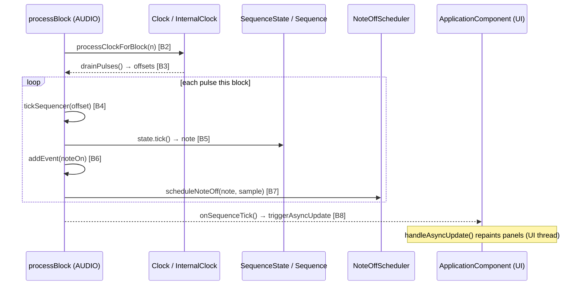

| Key | Where | Set the breakpoint to see… | `file:line` |
|-----|-------|----------------------------|-------------|
| B1 | `processBlock` (entry) | The per-block pipeline. **Make it a log point** (`Suspend` off) or a suspending one you disable quickly — it fires constantly. | [PluginProcessor.cpp#L179](https://github.com/regulus33/Gambler/blob/main/source/PluginProcessor.cpp#L179) |
| B2 | `processClockForBlock` | Internal vs DAW timing. In standalone you take the `processInternalClock` branch. Step into `InternalClock::processSamples`. | [PluginProcessor.cpp#L223](https://github.com/regulus33/Gambler/blob/main/source/PluginProcessor.cpp#L223) |
| B3 | pulse drain loop | `clock.drainPulses()` returning sub-block sample offsets — usually 0 or 1 per block, occasionally 2. | [PluginProcessor.cpp#L201](https://github.com/regulus33/Gambler/blob/main/source/PluginProcessor.cpp#L201) |
| B4 | `tickSequencer` | One step firing. **Condition: `note >= 0`** to skip rests. Watch `currentStepIndex`, `note`, `velocity`. | [PluginProcessor.cpp#L300](https://github.com/regulus33/Gambler/blob/main/source/PluginProcessor.cpp#L300) |
| B5 | `Sequence::tick` | The playhead advancing (`(currentIndex()+1) % len`) and the note being quantized. This is where "which note plays" is decided. | [Sequence.h#L183](https://github.com/regulus33/Gambler/blob/main/source/backend/Sequence.h#L183) |
| B6 | note-on emit | The actual `MidiMessage::noteOn` added to the block buffer (and sent to hardware). | [PluginProcessor.cpp#L326](https://github.com/regulus33/Gambler/blob/main/source/PluginProcessor.cpp#L326) |
| B7 | `scheduleNoteOff` | The note-off being scheduled at `noteOnSample + noteLength×samplesPerStep` — inspect `noteOffDelay`. It later fires in `processScheduledNoteOff`. | [PluginProcessor.cpp#L337](https://github.com/regulus33/Gambler/blob/main/source/PluginProcessor.cpp#L337) · [NoteOffScheduler.h#L29](https://github.com/regulus33/Gambler/blob/main/source/backend/NoteOffScheduler.h#L29) |
| B8 | `onSequenceTick` callback | The audio thread **poking the UI**: `triggerAsyncUpdate()` coalesces into one message-thread refresh. Put a second breakpoint at `handleAsyncUpdate` to land on the UI thread and confirm the hop. | [PluginProcessor.cpp#L347](https://github.com/regulus33/Gambler/blob/main/source/PluginProcessor.cpp#L347) · [ApplicationComponent.h#L292](https://github.com/regulus33/Gambler/blob/main/source/ui/ApplicationComponent.h#L292) |

---

### 10.4 Journey C — Roll + probability: random notes, spread out

This is the headline feature and the **clearest UI→audio→UI round trip in standalone.** Two
parts: (1) engaging Roll makes the audio thread *generate* random notes; (2) the probability
control decides *which steps* are allowed to fire — the "spread."

#### Part 1 — Roll generates random notes on the audio thread

**Do this:** press and hold the **Roll** button (dice icon, position 0 of the control row).

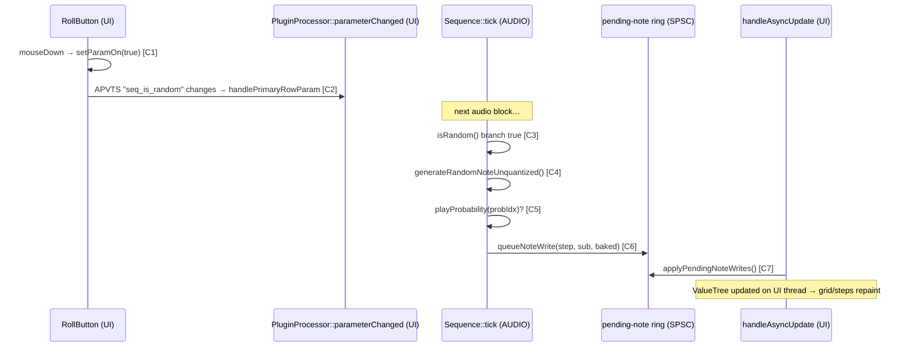

| Key | Where | Set the breakpoint to see… | `file:line` |
|-----|-------|----------------------------|-------------|
| C1 | `SequencerControlButton::mouseDown` | The button doing **nothing but** setting the APVTS param (observer pattern) — no direct action. | [SequencerControlButton.h#L140](https://github.com/regulus33/Gambler/blob/main/source/ui/buttons/SequencerControlButton.h#L140) |
| C2 | `handlePrimaryRowParam` (ROLL) | The param change becoming `state.setIsRandom(isOn)`. This runs on whatever thread set the param (here, UI). | [PluginProcessor.cpp#L473](https://github.com/regulus33/Gambler/blob/main/source/PluginProcessor.cpp#L473) |
| C3 | `Sequence::tick` random branch | The **audio thread** entering random mode. `⌥F8`: `isRandom()`. | [Sequence.h#L195](https://github.com/regulus33/Gambler/blob/main/source/backend/Sequence.h#L195) |
| C4 | `generateRandomNoteUnquantized` | A raw random note being drawn within the current range (`rangeMin..rangeMax`). Step out to see `scaleQ.bake()` fold it into scale/range. | [Sequence.h#L267](https://github.com/regulus33/Gambler/blob/main/source/backend/Sequence.h#L267) |
| C5 | probability gate | `if (!playProbability(probIdx))` → this step is silenced (returns −1). This is the **spread** in action per step. Watch `probIdx` and the boolean. | [Sequence.h#L198](https://github.com/regulus33/Gambler/blob/main/source/backend/Sequence.h#L198) |
| C6 | `queueNoteWrite` | The **audio→message ring**: the generated note is *not* written to the ValueTree here (not audio-safe) — it's queued. Inspect the write index. | [Sequence.h#L393](https://github.com/regulus33/Gambler/blob/main/source/backend/Sequence.h#L393) |
| C7 | `applyPendingNoteWrites` | The **UI thread** draining the ring and committing the notes to `InternalState`, which repaints the grid. This is the return leg. | [Sequence.h#L314](https://github.com/regulus33/Gambler/blob/main/source/backend/Sequence.h#L314) |

#### Part 2 — The probability slider sets the spread

**Do this:** drag the **Probability** knob in the Main Controls panel from 100% down to ~30%.
Fewer steps are allowed to play, clustered by the Eden pattern.

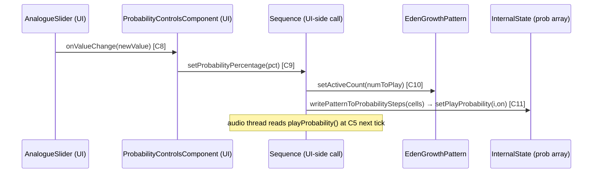

| Key | Where | Set the breakpoint to see… | `file:line` |
|-----|-------|----------------------------|-------------|
| C8 | `probabilitySlider.onValueChange` | The raw 0–1 slider value becoming a percentage. Note the `isUpdatingFromState` guard that prevents feedback loops. | [ProbabilityControlsComponent.cpp#L29](https://github.com/regulus33/Gambler/blob/main/source/ui/ProbabilityControlsComponent.cpp#L29) |
| C9 | `Sequence::setProbabilityPercentage` | Percentage → cell count on the current grid (`roundToNearest(pct, gridCells)`). | [Sequence.h#L108](https://github.com/regulus33/Gambler/blob/main/source/backend/Sequence.h#L108) |
| C10 | `EdenGrowthPattern::setActiveCount` | The pattern growing/shrinking its scatter **monotonically** (nudging back recovers the exact shape). | [EdenGrowthPattern.h#L59](https://github.com/regulus33/Gambler/blob/main/source/algorithms/probability/EdenGrowthPattern.h#L59) |
| C11 | `writePatternToProbabilitySteps` | The DxD pattern being tiled across the 64-step `playProbability` array in `InternalState` — the data the audio thread reads at **C5**. | [Sequence.h#L360](https://github.com/regulus33/Gambler/blob/main/source/backend/Sequence.h#L360) |

> **Connect the two halves:** with breakpoint **C5** still armed, change the probability and
> watch `probIdx`/`playProbability(probIdx)` flip for the steps the Eden pattern just turned
> off. That's the whole "randomize, but spread out" story in one round trip.

---

### 10.5 Journey D — Building a subsequence

A step can hold up to 8 **substeps** (a mini-arp inside one step). This edits per-step data in
`InternalState`, and playback walks a per-step cursor.

**Do this:** click a step to select it, then press **`+`** in the Subseq panel a couple times;
then click substep bars and edit their notes with the note slider.

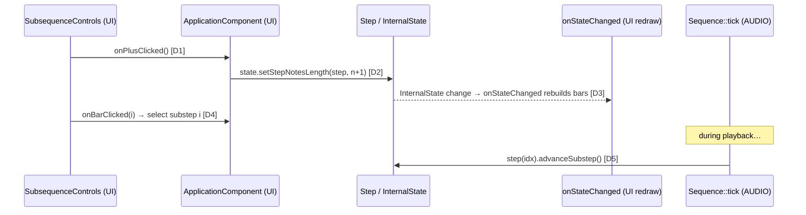

| Key | Where | Set the breakpoint to see… | `file:line` |
|-----|-------|----------------------------|-------------|
| D1 | `onPlusClicked` (subseq) | The `+` handler reading the selected step and bumping its substep count (capped at `MAX_SUBSTEPS`). | [ApplicationComponent.h#L477](https://github.com/regulus33/Gambler/blob/main/source/ui/ApplicationComponent.h#L477) |
| D2 | `Step::setSubstepCount` | The count being written into `InternalState` under `step_X_notes_len`. | [Step.h#L44](https://github.com/regulus33/Gambler/blob/main/source/backend/Step/Step.h#L44) |
| D3 | `SubsequenceControlsComponent::onStateChanged` | The bar UI rebuilding from state: which bars are real vs dashed placeholders, active vs selected, note labels/colours. | [SubsequenceControlsComponent.h#L128](https://github.com/regulus33/Gambler/blob/main/source/ui/SubsequencerComponent/SubsequenceControlsComponent.h#L128) |
| D4 | `onBarClicked` lambda | Selecting a substep for editing and pushing its note into the piano roll + note sliders. | [ApplicationComponent.h#L442](https://github.com/regulus33/Gambler/blob/main/source/ui/ApplicationComponent.h#L442) |
| D5 | `Step::advanceSubstep` | Playback walking the substep cursor `(current+1) % substepCount` each time this step is hit — the mini-arp. Reached from `Sequence::tick`/`tickStep`. | [Step.h#L88](https://github.com/regulus33/Gambler/blob/main/source/backend/Step/Step.h#L88) |

---

### 10.6 Journey E — A setting takes effect

Settings are just APVTS params. A settings widget writes the param on the UI thread; the audio
thread reads it on its next block. No locks, no direct calls into the audio path.

**Do this:** open **Settings** (gear icon), drag **Tempo**, then change **Note length**.

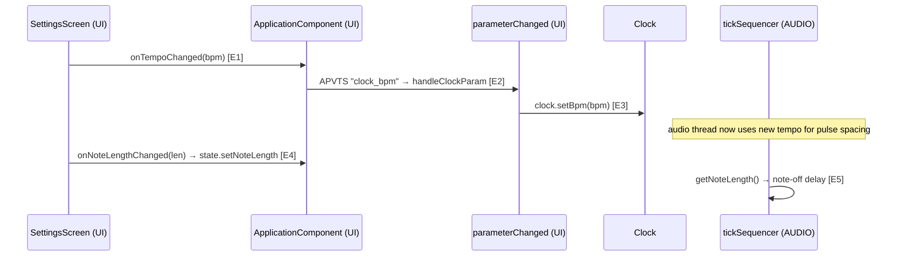

| Key | Where | Set the breakpoint to see… | `file:line` |
|-----|-------|----------------------------|-------------|
| E1 | `onTempoChanged` (wireSettingsClockCallbacks) | The slider value being written to the `clock_bpm` param via `setValueNotifyingHost`. | [ApplicationComponent.h#L574](https://github.com/regulus33/Gambler/blob/main/source/ui/ApplicationComponent.h#L574) |
| E2 | `handleClockParam` (CLOCK_BPM) | The param listener firing and translating the value for the `Clock`. Same function handles mode + subdivision. | [PluginProcessor.cpp#L636](https://github.com/regulus33/Gambler/blob/main/source/PluginProcessor.cpp#L636) |
| E3 | `InternalClock::setBpm` | The clamped BPM landing in the timing engine; next `calculateSamplesPerPulse()` uses it. | [InternalClock.h#L38](https://github.com/regulus33/Gambler/blob/main/source/backend/InternalClock.h#L38) |
| E4 | `onNoteLengthChanged` | A **pref** path: `state.setNoteLength()` writes an APVTS float — no clock involved. | [ApplicationComponent.h#L590](https://github.com/regulus33/Gambler/blob/main/source/ui/ApplicationComponent.h#L590) |
| E5 | note-off delay in `tickSequencer` | The audio thread **reading** that pref (`state.getNoteLength()`) to compute the scheduled note-off — the setting applied. | [PluginProcessor.cpp#L335](https://github.com/regulus33/Gambler/blob/main/source/PluginProcessor.cpp#L335) |

> **Try the clock mode too:** breakpoint [`handleClockParam`](https://github.com/regulus33/Gambler/blob/main/source/PluginProcessor.cpp#L613) and switch
> Internal ↔ External MIDI clock in Settings — watch `clock.setMode(...)` and how it flips which
> branch [`processClockForBlock`](https://github.com/regulus33/Gambler/blob/main/source/PluginProcessor.cpp#L223) takes.

---

### 10.7 Journey F — MIDI learn + incoming MIDI

Two related flows. **Learn** captures a mapping; afterward, **incoming MIDI** is routed to an
action. Incoming MIDI is parsed on the **audio thread** inside `processBlock`.

#### Part 1 — Teach a mapping

**Do this:** click the **MIDI-learn** button in the nav bar, click a control (say a step
button), then send a note/CC from a controller (or your computer keyboard if the virtual
keyboard is enabled).

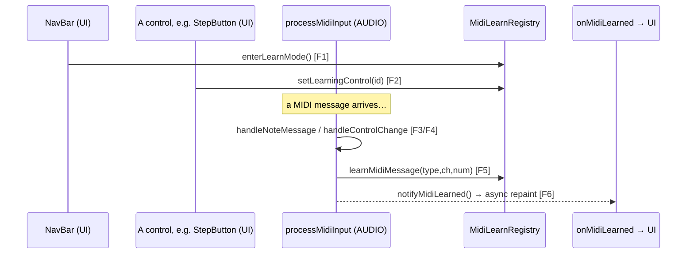

#### Part 2 — A learned control fires

**Do this:** exit learn mode and send that same message again.

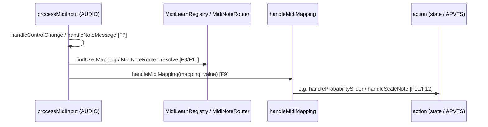

| Key | Where | Set the breakpoint to see… | `file:line` |
|-----|-------|----------------------------|-------------|
| F1 | learn-mode toggle | The nav button flipping the registry into learn mode. | [ApplicationComponent.h#L79](https://github.com/regulus33/Gambler/blob/main/source/ui/ApplicationComponent.h#L79) |
| F2 | `StepButton::mouseDown` (learn) | A clicked control arming itself as the learn target (`setLearningControl`) instead of doing its normal action. | [StepButton.h#L214](https://github.com/regulus33/Gambler/blob/main/source/ui/buttons/StepButton.h#L214) |
| F3 | `processMidiInput` | The **audio thread** iterating the incoming MIDI buffer. Every controller message enters here. | [PluginProcessor.cpp#L878](https://github.com/regulus33/Gambler/blob/main/source/PluginProcessor.cpp#L878) |
| F4 | `handleNoteMessage` | Note-specific dispatch; note the learn-mode guard that swallows the message so it doesn't also toggle a scale key. | [PluginProcessor.cpp#L928](https://github.com/regulus33/Gambler/blob/main/source/PluginProcessor.cpp#L928) |
| F5 | `MidiLearnRegistry::learnMidiMessage` | The mapping being stored both ways (`userMappings` + `controlToMidi`). Inspect the `MidiMessageIdentifier`. | [MidiLearnRegistry.h#L80](https://github.com/regulus33/Gambler/blob/main/source/backend/MidiLearnRegistry/MidiLearnRegistry.h#L80) |
| F6 | `notifyMidiLearned` | The audio thread poking the UI to repaint overlays (race-safe local copy of the callback). | [PluginProcessor.cpp#L986](https://github.com/regulus33/Gambler/blob/main/source/PluginProcessor.cpp#L986) |
| F7 | `handleControlChange` | (Post-learn) a CC arriving; `ccValue >= 64` becomes the boolean "on". | [PluginProcessor.cpp#L920](https://github.com/regulus33/Gambler/blob/main/source/PluginProcessor.cpp#L920) |
| F8 | `routeLearnableMessage` (map lookup) | CC → `findUserMapping`; if unmapped it returns early. This is where a message becomes a `MidiControlId`. | [PluginProcessor.cpp#L966](https://github.com/regulus33/Gambler/blob/main/source/PluginProcessor.cpp#L966) |
| F9 | `handleMidiMapping` (switch) | The big dispatch turning a `controlId` into an action. Watch `mapping.controlId`. | [PluginProcessor.cpp#L1151](https://github.com/regulus33/Gambler/blob/main/source/PluginProcessor.cpp#L1151) |
| F10 | `handleProbabilitySlider` | A concrete leaf action (a CC mapped to probability) mutating state — mirror image of [C9](#104-journey-c--roll--probability-random-notes-spread-out). | [PluginProcessor.cpp#L1036](https://github.com/regulus33/Gambler/blob/main/source/PluginProcessor.cpp#L1036) |
| F11 | `MidiNoteRouter::resolve` | For **notes**: user mapping first, else the default scale key (`note % 12`). Every note routes *somewhere*. | [MidiNoteRouter.h#L35](https://github.com/regulus33/Gambler/blob/main/source/backend/MidiNoteRouter.h#L35) |
| F12 | `handleScaleNote` | An incoming note (unmapped) toggling a scale key — latched vs momentary depending on `SCALE_LATCH`. | [PluginProcessor.cpp#L1127](https://github.com/regulus33/Gambler/blob/main/source/PluginProcessor.cpp#L1127) |

> **Bonus — external MIDI clock:** set the clock mode to External MIDI, then breakpoint
> [`handleTransportMessage`](https://github.com/regulus33/Gambler/blob/main/source/PluginProcessor.cpp#L892) and watch `0xF8` timing
> pulses accumulate in [`Clock::processExternalMidiClockPulse`](https://github.com/regulus33/Gambler/blob/main/source/backend/Clock.h#L245) until they cross a
> subdivision boundary and enqueue a step pulse — the same `pendingPulseOffsets` queue Journey B drains.

---

### 10.8 Suggested order & a mental model to keep

Run them **A → B → C → D → E → F**. By the end you'll have watched the same few patterns
recur, which is the real takeaway:

1. **UI never touches the audio thread directly.** It writes an **APVTS param** (or
   `InternalState`), and the audio thread reads it next block. (Journeys C1→C3, E1→E5.)
2. **Two lock-free rings** handle the cases where a value must move *now*, not "next param
   read": `PreviewMidiFifo` (UI→audio, previews) and the pending-note ring (audio→UI, Roll).
   (Journeys A, C.)
3. **Audio→UI is always deferred** through `AsyncUpdater` / `callAsync` so the audio thread
   never blocks on painting. (Journeys B8, C7, F6.)

If a value seems to "not update," ask *which* of those three mechanisms should have carried
it — that question resolves almost every bug in this codebase.
