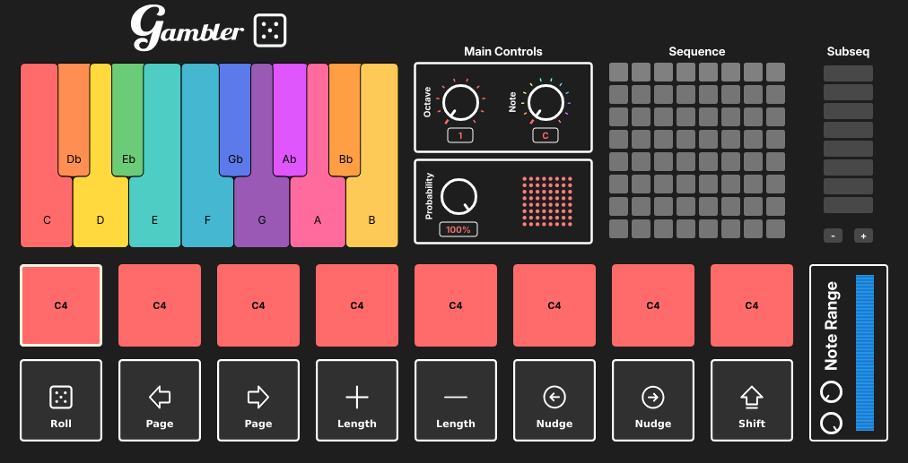
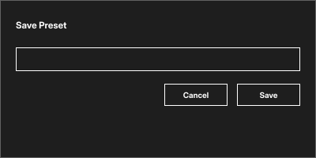
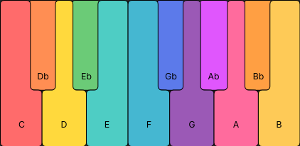
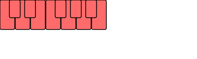
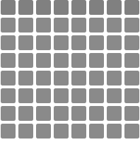
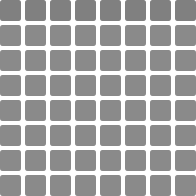
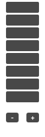

# Gambler2

A JUCE-based MIDI step sequencer plugin with probabilistic note generation, scale quantization, and per-step substep editing.

**Formats:** Standalone, AU, VST3, AUv3, CLAP
**Company:** ToneGarden

## Build

```bash
cmake -B build && cmake --build build                          # full build
cmake --build build --target Gambler2_Standalone                # standalone only
cmake --build build --target Tests && ./build/Tests             # run all tests
UPDATE_SNAPSHOTS=1 ./build/Tests "[visual]"                    # update visual goldens
```

Requires C++23, JUCE 8.0.x, ninja.

---

## UI Component Inventory

### Component Hierarchy

```
ApplicationComponent
├─ MainScreenComponent
│  ├─ NavBarComponent
│  │  ├─ PresetSelectorComponent
│  │  │  ├─ PresetDropdownComponent
│  │  │  └─ PresetCycleButton (×2)
│  │  ├─ LogoComponent
│  │  ├─ ToggleIconButton (×6: MIDI Learn, Settings, Play/Pause, Stop, Compact, Swap)
│  │  ├─ ScaleLatchButton
│  │  ├─ ExportButton
│  │  └─ SubdivisionSlider
│  ├─ PianoRollComponent
│  ├─ MainControlsComponent
│  │  ├─ NoteControlsComponent
│  │  │  ├─ OctaveSlider (NotchedSlider)
│  │  │  └─ NoteSlider (NotchedSlider)
│  │  └─ ProbabilityControlsComponent
│  │     ├─ AnalogueSlider (ProbabilitySlider)
│  │     └─ ProbabilityGauge
│  ├─ SequenceOverviewComponent
│  │  └─ SequenceGrid
│  ├─ SequencerStepsComponent
│  │  └─ StepButton (×8)
│  ├─ SequencerControlsComponent
│  │  ├─ RollButton
│  │  ├─ ShiftButton
│  │  ├─ Normal mode: PageLeft, PageRight, Length+, Length−, NudgeLeft, NudgeRight
│  │  └─ Shift mode:  Duplicate, ClearWindow, ClearStep, RandAll, RandStep, Shuffle
│  ├─ SubsequenceControlsComponent
│  │  ├─ SubsequenceBar → SingleBar (×8)
│  │  └─ SubsequenceButton (−/+)
│  └─ NoteRangeControlsComponent
│     ├─ NoteRangeGauge
│     └─ Slider (offset/size)
│
└─ SettingsScreenComponent
   ├─ NavBarComponent (shared)
   ├─ GlobalScaleQuantizerComponent
   ├─ NoteColourPickerComponent
   └─ SettingsGroup (multiple)
```

### Main Screens

| Component | File | Snapshot | Description |
|-----------|------|----------|-------------|
| ApplicationComponent | `source/ui/ApplicationComponent.h` |  | Top-level orchestrator; swaps between main and settings screens |
| MainScreenComponent | `source/ui/MainScreenComponent.h` |  | Primary sequencer workspace with all controls |
| SettingsScreenComponent | `source/ui/SettingsScreenComponent.h` |  | Full-screen settings (Clock, Playback, MIDI config) |
| PluginEditor | `source/PluginEditor.h` |  | JUCE editor wrapper; handles keyboard input and responsive scaling |

### Navigation Bar

| Component | File | Snapshot | Description |
|-----------|------|----------|-------------|
| NavBarComponent | `source/ui/NavBarComponent.h` |  | Top bar with preset selector, transport, tools, settings |
| LogoComponent | `source/ui/LogoComponent.h` |  | "Gambler" text logo with dice icon |
| PresetSelectorComponent | `source/ui/PresetSelectorComponent.h` |  | Dropdown + cycle buttons for preset navigation |
| PresetDropdownComponent | `source/ui/PresetDropdownComponent.h` |  | ComboBox-based preset selection |
| SavePresetDialogComponent | `source/ui/SavePresetDialogComponent.h` |  | Modal dialog for saving presets |
| ExportButton | `source/ui/NavBarComponent.h` | — | Click-to-save or drag-to-DAW MIDI export |
| ScaleLatchButton | `source/ui/ScaleLatchButton.h` |  | Toggle momentary/latched scale editing |
| SubdivisionSlider | `source/ui/sliders/SubdivisionSlider.h` |  | Clock division selector (1/4, 1/8, 1/16, 1/32) |
| ToggleIconButton | `source/ui/ToggleIconButton.h` |  | Generic two-state icon button (used for Settings, Play, Stop, etc.) |

### Piano Roll & Scale

| Component | File | Snapshot | Description |
|-----------|------|----------|-------------|
| PianoRollComponent | `source/ui/PianoRollComponent.h` |  | 12-key chromatic keyboard for global scale selection |
| GlobalScaleQuantizerComponent | `source/ui/GlobalScaleQuantizerComponent.h` |  | Scale type dropdown + preset scale buttons (settings) |
| NoteColourPickerComponent | `source/ui/NoteColourPickerComponent.h` |  | Per-note colour customization (settings) |

### Main Controls

| Component | File | Snapshot | Description |
|-----------|------|----------|-------------|
| MainControlsComponent | `source/ui/MainControlsComponent.h` |  | Container for note/octave + probability controls |
| NoteControlsComponent | `source/ui/NoteControlsComponent.h` |  | Bordered panel with OctaveSlider + NoteSlider |
| OctaveSlider | `source/ui/sliders/OctaveSlider.h` | — | Discrete rotary for octave (0-9) |
| NoteSlider | `source/ui/sliders/NoteSlider.h` | — | Discrete rotary for pitch class (C-B), scale-filtered |
| NotchedSlider | `source/ui/sliders/NotchedSlider.h` | — | Base discrete rotary with colored dot notches |
| ProbabilityControlsComponent | `source/ui/ProbabilityControlsComponent.h` |  | Probability slider + visual gauge |
| AnalogueSlider | `source/ui/sliders/ProbabilitySlider.h` | — | Continuous rotary for probability (0-100%) |
| ProbabilityGauge | `source/ui/ProbabilityGauge.h` |  | 8×8 grid visualizing random probability distribution |

### Sequencer

| Component | File | Snapshot | Description |
|-----------|------|----------|-------------|
| SequencerStepsComponent | `source/ui/SequencerStepsComponent.h` |  | 8 visible steps (window into 64-step sequence) |
| StepButton | `source/ui/buttons/StepButton.h` |  | Individual step: shows note name, selection state, playhead |
| SequencerControlsComponent | `source/ui/SequencerControlsComponent.h` |  | 8-button row with normal/shift modes |
| SequenceOverviewComponent | `source/ui/SequenceOverviewComponent.h` |  | 8×8 grid overview of entire 64-step sequence |
| SequenceGrid | `source/ui/SequenceGrid.h` |  | Clickable grid for navigation and length adjustment |

### Sequencer Control Buttons

All inherit from `SequencerControlButton` (`source/ui/buttons/SequencerControlButton.h`).

**Normal Mode (Shift OFF):**

| Pos | Button | File | APVTS Param | Function |
|-----|--------|------|-------------|----------|
| 0 | RollButton | `buttons/RollButton.h` | SEQ_IS_RANDOM | Momentary random mode |
| 1 | PageLeftButton | `buttons/PageLeftButton.h` | INDEX_LEFT | Page window left 8 steps |
| 2 | PageRightButton | `buttons/PageRightButton.h` | INDEX_RIGHT | Page window right 8 steps |
| 3 | LengthPlusButton | `buttons/LengthPlusButton.h` | LENGTH_PLUS | Increase sequence length |
| 4 | LengthMinusButton | `buttons/LengthMinusButton.h` | LENGTH_MINUS | Decrease sequence length |
| 5 | NudgeLeftButton | `buttons/NudgeLeftButton.h` | NUDGE_LEFT | Shift all notes left |
| 6 | NudgeRightButton | `buttons/NudgeRightButton.h` | NUDGE_RIGHT | Shift all notes right |
| 7 | ShiftButton | `buttons/ShiftButton.h` | SEQ_IS_SHIFT | Toggle shift mode |

**Shift Mode (Shift ON) — buttons 1-6 swap:**

| Pos | Button | File | APVTS Param | Function |
|-----|--------|------|-------------|----------|
| 1 | DuplicateButton | `buttons/DuplicateButton.h` | DUPLICATE | Double length + copy |
| 2 | ClearWindowButton | `buttons/ClearWindowButton.h` | CLEAR_WINDOW | Clear visible 8 steps |
| 3 | ClearStepButton | `buttons/ClearStepButton.h` | CLEAR_STEP | Clear selected step |
| 4 | RandomizeAllButton | `buttons/RandomizeAllButton.h` | RANDOMIZE_ALL | Randomize all steps |
| 5 | RandomizeStepButton | `buttons/RandomizeStepButton.h` | RANDOMIZE_STEP | Randomize current step |
| 6 | ShuffleButton | `buttons/ShuffleButton.h` | SHUFFLE | Shuffle step order |

Shift-mode buttons share MIDI mappings with their normal-mode counterparts.

### Subsequence & Note Range

| Component | File | Snapshot | Description |
|-----------|------|----------|-------------|
| SubsequenceControlsComponent | `source/ui/SubsequenceControlsComponent.h` |  | Per-step substep editing (up to 8 variations) |
| NoteRangeControlsComponent | `source/ui/NoteRangeControlsComponent.h` |  | MIDI note range window (offset + size sliders + gauge) |

### Settings

| Component | File | Snapshot | Description |
|-----------|------|----------|-------------|
| SettingsGroup | `source/ui/SettingsGroup.h` |  | Reusable titled container for grouped settings |

### Base Classes & Utilities

| Class | File | Description |
|-------|------|-------------|
| StateListenerComponent | `source/ui/StateListenerComponent.h` | Base for all APVTS-observing components (thread-safe async updates) |
| Icons | `source/ui/Icons.h` | Centralized SVG path factory for all icons |
| UIConstants | `source/ui/UIConstants.h` | Global colour constants |
| MusicConstants | `source/ui/MusicConstants.h` | Note names, colours, octave labels |
| MidiLearnOverlayPainter | `source/ui/MidiLearnOverlayPainter.h` | Blue overlay drawn during MIDI learn mode |

---

## Backend Class Diagram


---

## Possible Dead Code

| Item | File(s) | Status | Notes |
|------|---------|--------|-------|
| `ScaleClearButton` class | `source/ui/ScaleClearButton.h` | **Orphaned** | Removed from NavBarComponent but file still exists. Not included anywhere |
| `CLEAR_SCALE` APVTS param | `source/data/Params.h:150`, `PluginProcessor.cpp:787` | **Orphaned** | Handler in PluginProcessor still active but no UI to trigger it |
| `createBarChartIcon()` | `source/ui/Icons.h` | **Unused** | Never called anywhere |
| `createCrossHairIcon()` | `source/ui/Icons.h` | **Unused** | Never called anywhere |
| `createKeyboardIcon()` | `source/ui/Icons.h` | **Unused** | Never called anywhere |
| `createRecordIcon()` | `source/ui/Icons.h` | **Unused** | Never called anywhere |
| `scale_clear_button.png` | `tests/snapshots/` | **Stale** | No corresponding test case in VisualSnapshotTests.cpp |
| `settings_window.png` | `tests/snapshots/` | **Stale** | No corresponding test case (SettingsWindowComponent test was removed) |
| `length_plus_sequence_overview.png` + ACTUAL/DIFF | `tests/snapshots/` | **Stale** | No corresponding test case in VisualSnapshotTests.cpp |

---

## Tests

```bash
cmake -B build && cmake --build build --target Tests && ./build/Tests
```

Visual snapshot tests live in `tests/VisualSnapshotTests.cpp`. Golden images are in `tests/snapshots/`.


#### Docs

 The .tex source is alongside it if you want to tweak anything. You can rebuild it with:                                                 
 `cd docs && pdflatex gambler-codebase-guide.tex && pdflatex gambler-codebase-guide.tex`
(two passes needed for the table of contents and cross-references)                                                                      
                                                                       
                                                                       ```