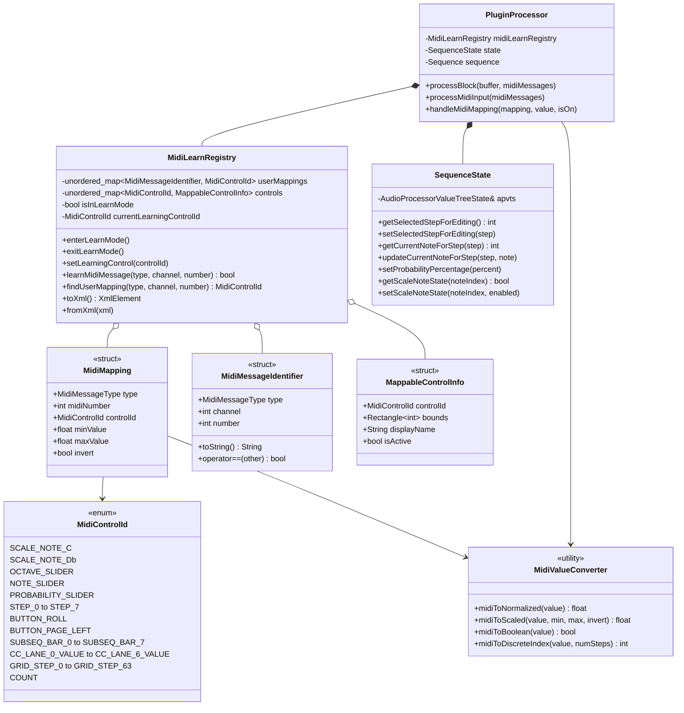
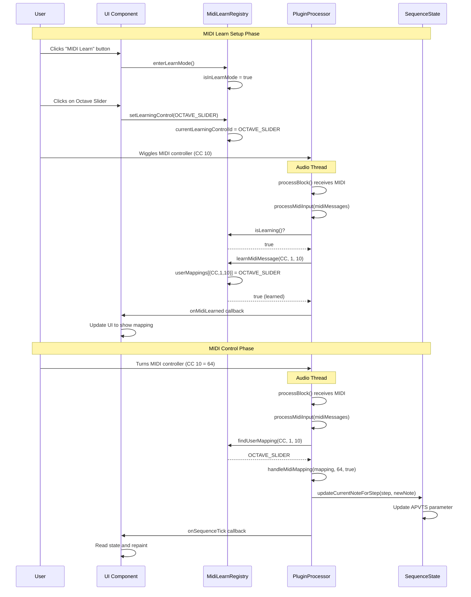
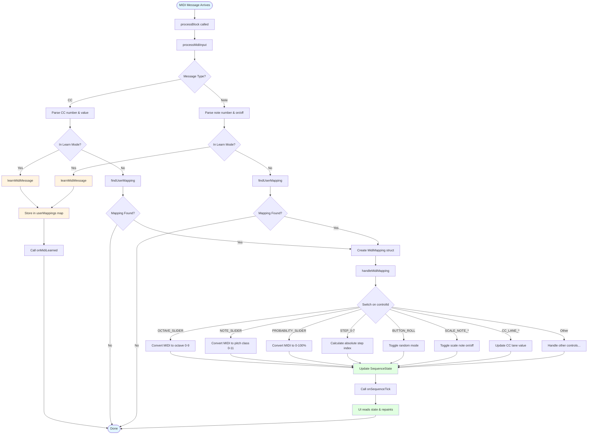

# Gambler

A MIDI sequencer plugin with probabilistic and generative features, inspired by modules like Turing Machine and Music Thing Modular's Turing Machine.

## Platforms

- **macOS**: Standalone, AU, VST3, AUv3
- **iOS/iPadOS**: Standalone app and AUv3 plugin (iOS 12.0+)

## Quick Start

### macOS
```bash
# Build
/Applications/CLion.app/Contents/bin/cmake/mac/aarch64/bin/cmake -Bcmake-build-debug
/Applications/CLion.app/Contents/bin/cmake/mac/aarch64/bin/cmake --build cmake-build-debug --target Gambler2_Standalone -j 8

# Run
./cmake-build-debug/Gambler2_artefacts/Debug/Standalone/Gambler.app/Contents/MacOS/Gambler
```

### iOS/iPadOS
```bash
# Build for simulator
./build-ios.sh

# Build for device
./build-ios.sh --device

# Open in Xcode
./open-xcode.sh
```

**📱 First-time iOS setup?** See [iOS-First-Time-Setup.md](iOS-First-Time-Setup.md) for a step-by-step guide.

**📚 Full iOS documentation:** [docs/iOS-Build-Guide.md](docs/iOS-Build-Guide.md)

## Architecture

### Layered Architecture (Option 3)

```
┌─────────────────────────────────────┐
│  Presentation Layer (UI Thread)     │
│  - JUCE Components                  │
│  - Button/Slider listeners          │
└──────────────┬──────────────────────┘
               │ Commands/Queries
┌──────────────▼──────────────────────┐
│  Application Layer                  │
│  - AudioProcessor (Controller)      │
│  - Command handlers                 │
│  - APVTS (persistence adapter)      │
└──────────────┬──────────────────────┘
               │ Method calls
┌──────────────▼──────────────────────┐
│  Domain Layer (Thread-safe)         │
│  - Controls (aggregate root)        │
│  - Sequence, Note, etc.             │
│  - Pure C++, no JUCE dependencies   │
└─────────────────────────────────────┘
```

**Key Principles:**
- **Domain Layer**: Pure C++ business logic, fully testable without JUCE
- **Application Layer**: PluginProcessor acts as controller, syncing APVTS ↔ Controls
- **Presentation Layer**: JUCE UI components (to be implemented)
- **Persistence**: APVTS handles all parameter state saving/loading
- **Thread Safety**: Clear boundaries for adding locks/atomics when needed

## Sequencer Capabilities

### Current Features

#### 1. **Sequence Management**
- **64 steps** by default (configurable length)
- Each step contains a `Note` object with:
  - MIDI note value (0-127)
  - Subsequence of up to 8 notes for evolving patterns
  - 7 configurable slots for velocity/CC data

#### 2. **Note Subsequences**
- Each step can have **1-8 substep notes** that cycle through on each sequence pass
- Creates **evolving patterns** where steps change slightly on each loop
- Similar to Turing Machine's probabilistic evolution
- Substeps are triggered when their parent step triggers (not by faster clock divisions)

#### 3. **Roll (Randomization)**
- **Roll button** in Controls triggers note randomization
- When Roll is pressed, `Sequence.tick()` randomizes the current step's note (0-127)
- Allows for generative, unpredictable sequences
- Can be toggled on/off via Controls

#### 4. **Scale Quantization** (In Progress)
- `State` contains a 12-position scale array
- Each position represents a chromatic note: C, Db, D, Eb, E, F, Gb, G, Ab, A, Bb, B
- Values of 1 = note is in scale, 0 = note is excluded
- Example: C Major = `[1, 0, 1, 0, 1, 1, 0, 1, 0, 1, 0, 1]`
- **Next step**: Implement quantization logic to constrain randomized notes to the active scale

#### 5. **State Integration**
- `State` object acts as the central domain state container
- Contains all application state:
  - 13 button states (Roll, Shift, Index navigation, etc.)
  - 3 main controls (Octave, Note, Probability)
  - MIDI mode (CC_TO_NOTE, NOTE_TO_CC)
  - Note range (min/max)
  - 8 step buttons (selected/highlighted states)
  - 7 CC slots (number + value for each)
  - 12-note scale array for quantization

#### 6. **Slot System**
- Each Note has **7 slots** for additional MIDI data
- Slot 0: Defaults to Velocity
- Slots 1-6: Default to CC (configurable CC numbers and values)
- Each slot can be configured for different CC types
- Supports CC values 0-127

### Architecture Details

#### Domain Objects

**`Sequence`**
- Manages 64 Note objects
- Handles sequence playback via `tick()`
- Integrates with State for Roll functionality and scale quantization
- Configurable sequence length with wrapping

**`Note`**
- Contains a vector of 1-8 MIDI note values (subsequence)
- Has its own internal index for cycling through substeps
- Contains 7 Slot objects for velocity/CC data
- Validates MIDI note values (0-127)

**`State`**
- Central domain state container for all application state
- Provides clean getter/setter API
- Validates all input values
- Contains scale quantization data (12-note array)
- No JUCE dependencies (pure C++)
- The actual UI controls interface will be closer to the UI layer

**`Slot`**
- Represents velocity or CC data
- Configurable type (Velocity or CC)
- Validates CC numbers (0-127) and values (0-127)

### Testing

All domain logic is fully tested using **Catch2** with the `--reporter rspec` option:

```bash
./cmake-build-debug/Tests --reporter rspec
```

**Test Coverage:**
- ✅ Note subsequence behavior and cycling
- ✅ Sequence length and wrapping
- ✅ Roll button randomization
- ✅ Scale configuration via State
- ✅ Slot configuration and validation
- ✅ State management
- ✅ MIDI note validation

### Next Steps

1. **Implement scale quantization logic** in Sequence.tick()
2. **Build UI components** for the Presentation Layer
3. **Add thread safety** (atomics/locks) for audio thread access
4. **Implement MIDI output** in AudioProcessor
5. **Add clock/tempo synchronization**
6. **Implement probability controls** for generative behavior

## Note Preview System

### ELI12 Summary

When you turn the note slider, you hear the note play immediately - like pressing a key on a piano to hear what it sounds like before you commit to it. The tricky part is that the plugin works in two different modes:

1. **Standalone mode** (when you run it as its own app): The note goes straight to your MIDI device, like a direct wire from the slider to your synthesizer.

2. **Plugin mode** (when you run it inside a DAW like Ableton or Bitwig): The note has to be carefully passed from the UI thread (where you're clicking) to the audio thread (where MIDI actually gets sent), like passing a note between two people who can't talk directly to each other.

The system also respects a "preview on/off" setting, so you can disable the preview if you find it annoying while editing.

---

### Detailed Technical Overview

The note preview system allows users to audition notes in real-time as they adjust the note and octave sliders in the UI. This feature works differently depending on whether the plugin is running in **standalone mode** or as a **plugin inside a DAW**.

#### Architecture Overview

```
┌─────────────────────────────────────────────────────────────────┐
│                         UI Thread                                │
│  ┌────────────────────────────────────────────────────────────┐ │
│  │  NoteControlsComponent                                      │ │
│  │  - User turns note slider                                   │ │
│  │  - onNoteChanged callback fires                             │ │
│  └────────────────┬───────────────────────────────────────────┘ │
│                   │                                              │
│  ┌────────────────▼───────────────────────────────────────────┐ │
│  │  PluginEditor                                               │ │
│  │  - Receives callback                                        │ │
│  │  - Queues ProcessorCommand to update domain state          │ │
│  │  - Checks if preview is enabled                             │ │
│  │  - Calls processorRef.triggerCurrentStepMidi()              │ │
│  └────────────────┬───────────────────────────────────────────┘ │
└───────────────────┼──────────────────────────────────────────────┘
                    │
┌───────────────────▼──────────────────────────────────────────────┐
│                    PluginProcessor                                │
│  ┌──────────────────────────────────────────────────────────────┐│
│  │  triggerCurrentStepMidi()                                    ││
│  │  - Gets current step's note from Sequence                    ││
│  │  - Sends note-off for previous note (if any)                 ││
│  │  - Sends note-on for new note                                ││
│  │                                                               ││
│  │  Decision: Standalone or Plugin mode?                        ││
│  │  ┌─────────────────────┬──────────────────────────────────┐ ││
│  │  │ if (midiOutput)     │ else (DAW mode)                  │ ││
│  │  │ STANDALONE MODE     │ PLUGIN MODE                      │ ││
│  │  └─────────────────────┴──────────────────────────────────┘ ││
│  └──────────────────────────────────────────────────────────────┘│
└───────────────────┬──────────────────────┬────────────────────────┘
                    │                      │
    ┌───────────────▼──────────┐  ┌────────▼─────────────────────┐
    │   STANDALONE PATH        │  │   PLUGIN/DAW PATH            │
    │                          │  │                              │
    │  midiOutput->            │  │  previewMidiFifo.            │
    │    sendMessageNow()      │  │    prepareToWrite()          │
    │                          │  │                              │
    │  ✓ Immediate send        │  │  previewMidiBuffer[i] =      │
    │  ✓ Direct to MIDI device │  │    {note, isNoteOn, vel}     │
    │  ✓ No thread sync needed │  │                              │
    │                          │  │  previewMidiFifo.            │
    │                          │  │    finishedWrite()           │
    │                          │  │                              │
    │                          │  │  ✓ Thread-safe queue         │
    │                          │  │  ✓ Processed in audio thread │
    └──────────────────────────┘  └────────┬─────────────────────┘
                                           │
                              ┌────────────▼─────────────────────┐
                              │   Audio Thread (processBlock)    │
                              │                                  │
                              │  previewMidiFifo.prepareToRead() │
                              │  for each queued message:        │
                              │    - Create MidiMessage          │
                              │    - Add to midiMessages buffer  │
                              │  previewMidiFifo.finishedRead()  │
                              │                                  │
                              │  ✓ Safe for real-time audio      │
                              │  ✓ Sent to DAW's MIDI output     │
                              └──────────────────────────────────┘
```

---

### Code Flow: Step by Step

#### 1. User Interaction (UI Thread)

When the user turns the note slider, the callback in `PluginEditor.cpp` is triggered:

<augment_code_snippet path="source/PluginEditor.cpp" mode="EXCERPT">
````cpp
mainControls.getNoteControls().onNoteChanged = [this](int pitchClass) {
    // Queue command to modify state on audio thread
    processorRef.queueCommand(ProcessorCommand([this, pitchClass]() {
        // ... update domain state ...
    }));

    // Trigger MIDI preview if enabled
    bool previewEnabled = processorRef.getUserPreferences().previewNotesOnEdit;
    if (previewEnabled) {
        processorRef.triggerCurrentStepMidi();
    }
};
````
</augment_code_snippet>

**Key Points:**
- The domain state update is queued as a command (thread-safe)
- Preview is only triggered if `previewNotesOnEdit` is enabled in UserPreferences
- The same pattern applies to octave changes

---

#### 2. Preview Trigger (PluginProcessor)

The `triggerCurrentStepMidi()` method in `PluginProcessor.cpp` handles the preview:

<augment_code_snippet path="source/PluginProcessor.cpp" mode="EXCERPT">
````cpp
void PluginProcessor::triggerCurrentStepMidi() {
    int currentStep = sequence.getCurrentIndex();
    const auto& step = sequence.getStep(currentStep);
    int note = step.getStepNotes().getCurrentNote().getNoteNumber();

    // Send note off for previous note (if any)
    if (lastPlayedNote >= 0) {
        if (midiOutput) {
            // Standalone mode: send directly
            auto noteOff = juce::MidiMessage::noteOff(1, lastPlayedNote, (juce::uint8)0);
            midiOutput->sendMessageNow(noteOff);
        } else {
            // DAW mode: queue for audio thread
            // ... (see below)
        }
    }
    // ... (similar for note on)
}
````
</augment_code_snippet>

---

#### 3A. Standalone Mode Path

In standalone mode, `midiOutput` is initialized during plugin construction:

<augment_code_snippet path="source/PluginProcessor.cpp" mode="EXCERPT">
````cpp
PluginProcessor::PluginProcessor() {
    // Open first available MIDI output device for standalone mode
    auto midiOutputs = juce::MidiOutput::getAvailableDevices();
    if (!midiOutputs.isEmpty()) {
        midiOutput = juce::MidiOutput::openDevice(midiOutputs[0].identifier);
        if (midiOutput) {
            DBG("Opened MIDI output: " << midiOutputs[0].name);
        }
    }
}
````
</augment_code_snippet>

**Standalone Preview Flow:**
```
User turns slider
    ↓
triggerCurrentStepMidi() called
    ↓
midiOutput->sendMessageNow(noteOn)
    ↓
MIDI sent immediately to hardware/virtual MIDI device
    ↓
User hears note instantly
```

**Advantages:**
- ✅ Immediate, zero-latency preview
- ✅ Simple, direct path
- ✅ No thread synchronization needed (UI thread can safely call sendMessageNow)

---

#### 3B. Plugin/DAW Mode Path

In plugin mode, `midiOutput` is `nullptr`, so we use a thread-safe FIFO queue:

<augment_code_snippet path="source/PluginProcessor.cpp" mode="EXCERPT">
````cpp
// DAW mode: queue for audio thread
int start1, size1, start2, size2;
previewMidiFifo.prepareToWrite(1, start1, size1, start2, size2);
if (size1 > 0) {
    previewMidiBuffer[start1] = { note, true, 100 };
    previewMidiFifo.finishedWrite(1);
    DBG("Preview MIDI Note ON queued (DAW): " << note);
}
````
</augment_code_snippet>

The audio thread then reads from this queue in `processBlock()`:

<augment_code_snippet path="source/PluginProcessor.cpp" mode="EXCERPT">
````cpp
void PluginProcessor::processBlock(juce::AudioBuffer<float>&, juce::MidiBuffer& midiMessages) {
    // Process any queued preview MIDI messages (from UI thread)
    int start1, size1, start2, size2;
    previewMidiFifo.prepareToRead(previewMidiFifo.getNumReady(), start1, size1, start2, size2);

    for (int i = 0; i < size1; ++i) {
        const auto& msg = previewMidiBuffer[start1 + i];
        if (msg.isNoteOn) {
            auto noteOn = juce::MidiMessage::noteOn(1, msg.noteNumber, msg.velocity);
            midiMessages.addEvent(noteOn, 0);
        }
        // ... (similar for note off)
    }
    // ...
}
````
</augment_code_snippet>

**Plugin/DAW Preview Flow:**
```
User turns slider (UI thread)
    ↓
triggerCurrentStepMidi() called (UI thread)
    ↓
Write to previewMidiFifo (lock-free, thread-safe)
    ↓
[Wait for next audio callback...]
    ↓
processBlock() called (Audio thread)
    ↓
Read from previewMidiFifo
    ↓
Add MIDI messages to midiMessages buffer
    ↓
DAW receives MIDI and routes to instruments
    ↓
User hears note (with slight latency)
```

**Why This Complexity?**
- ⚠️ **Thread Safety**: UI thread and audio thread cannot directly share data
- ⚠️ **Real-time Safety**: Audio thread must never block or allocate memory
- ⚠️ **DAW Integration**: MIDI must go through the DAW's routing system
- ✅ **Solution**: Lock-free FIFO queue (`juce::AbstractFifo`) allows safe communication

---

### Thread Safety Details

The `previewMidiFifo` is a **lock-free ring buffer** that allows:
- UI thread to write preview MIDI messages
- Audio thread to read preview MIDI messages
- No locks, no blocking, no memory allocation
- Safe for real-time audio processing

**Data Structure:**
<augment_code_snippet path="source/PluginProcessor.h" mode="EXCERPT">
````cpp
// Preview MIDI queue (for UI-triggered notes in DAW mode)
struct PreviewMidiMessage {
    int noteNumber;
    bool isNoteOn;
    juce::uint8 velocity;
};
juce::AbstractFifo previewMidiFifo { 32 };  // Ring buffer for up to 32 messages
std::array<PreviewMidiMessage, 32> previewMidiBuffer;
````
</augment_code_snippet>

---

### User Preferences Integration

The preview system respects the `previewNotesOnEdit` setting in `UserPreferences`:

<augment_code_snippet path="source/backend/UserPreferences.h" mode="EXCERPT">
````cpp
struct UserPreferences {
    bool previewNotesOnEdit = true;  // Whether to trigger MIDI preview when editing notes

    // Serialize/deserialize to XML for persistence
    std::unique_ptr<juce::XmlElement> toXml() const;
    void fromXml(const juce::XmlElement& xml);
};
````
</augment_code_snippet>

Users can toggle this setting in the Settings window, and it persists with the project state.

---

### Summary: Standalone vs Plugin Mode

| Aspect | Standalone Mode | Plugin/DAW Mode |
|--------|----------------|-----------------|
| **MIDI Output** | Direct to hardware via `midiOutput->sendMessageNow()` | Queued to audio thread via `previewMidiFifo` |
| **Latency** | Instant (< 1ms) | Slight delay (one audio buffer, ~5-20ms) |
| **Thread Safety** | Simple (UI thread can send directly) | Complex (lock-free FIFO queue) |
| **Initialization** | `juce::MidiOutput::openDevice()` in constructor | No MIDI device, `midiOutput == nullptr` |
| **Detection** | `if (midiOutput)` check | `else` branch (no midiOutput) |
| **Routing** | Direct to MIDI device | Through DAW's MIDI routing system |

---

### Related Code Files

- **`source/ui/NoteControlsComponent.h`** - Note/octave sliders with callbacks
- **`source/PluginEditor.cpp`** - Wires up slider callbacks to processor
- **`source/PluginProcessor.h`** - Declares `triggerCurrentStepMidi()` and FIFO queue
- **`source/PluginProcessor.cpp`** - Implements preview logic for both modes
- **`source/backend/UserPreferences.h`** - Stores `previewNotesOnEdit` setting
- **`source/ui/SettingsWindowComponent.h`** - UI toggle for preview on/off

---

# State recall and persistence (basic not counting presets yet)
Basically we get callbacks sent to `PluginProcessor`
The main things to look at are what bitwig calls in save and load of projects
`PluginProcessor::getStateInformation`
`PluginProcessor::setStateInformation`

All we are doing is loading and saving state as xml.
...


## MIDI Mapping System

The MIDI mapping system allows users to control any UI element via MIDI CC or Note messages through a "MIDI Learn" interface.

### Architecture Overview



### MIDI Learn Flow



### MIDI Input Processing Flow



### Data Structures

**User Mappings Storage:**
```cpp
// Key: MIDI message identifier (type, channel, number)
// Value: Control ID to trigger
std::unordered_map<MidiMessageIdentifier, MidiControlId> userMappings;

// Example entries:
// { {CC, 1, 10} → OCTAVE_SLIDER }
// { {CC, 1, 11} → NOTE_SLIDER }
// { {NOTE, 1, 36} → BUTTON_ROLL }
```

**Reverse Lookup (for UI display):**
```cpp
// Key: Control ID
// Value: MIDI message assigned to it
std::unordered_map<MidiControlId, MidiMessageIdentifier> controlToMidi;
```

### Thread Safety

- **MIDI Learn State**: Modified on audio thread, read on UI thread
- **User Mappings**: Written during learn (audio thread), read during playback (audio thread)
- **UI Updates**: `onMidiLearned` callback uses `AsyncUpdater` for thread-safe UI updates
- **State Changes**: All state modifications go through `SequenceState` which wraps APVTS (thread-safe)

### Persistence

User mappings are saved to XML in the plugin state:

```xml
<MidiLearnRegistry>
  <Mapping type="0" channel="1" number="10" controlId="45"/>
  <Mapping type="0" channel="1" number="11" controlId="46"/>
  <Mapping type="1" channel="1" number="36" controlId="55"/>
</MidiLearnRegistry>
```

This is automatically saved/loaded via `getStateInformation()` / `setStateInformation()`.

---

## Source Code Review Checklist

### Main Plugin Files
- [x] [source/PluginProcessor.h](source/PluginProcessor.h)
- [ ] [source/PluginProcessor.cpp](source/PluginProcessor.cpp)
- [ ] [source/PluginEditor.h](source/PluginEditor.h)
- [ ] [source/PluginEditor.cpp](source/PluginEditor.cpp)

### Backend - Domain Layer
- [x] [source/backend/Clock.h](source/backend/Clock.h)
- [ ] [source/backend/ClockMode.h](source/backend/ClockMode.h)
- [x] [source/backend/DawSync.h](source/backend/DawSync.h)
- [ ] [source/backend/InternalClock.h](source/backend/InternalClock.h)
- [ ] [source/backend/Sequence.h](source/backend/Sequence.h)
- [ ] [source/backend/SequenceState.h](source/backend/SequenceState.h)
- [ ] [source/backend/Step.h](source/backend/Step.h)
- [ ] [source/backend/StepNote.h](source/backend/StepNote.h)
- [ ] [source/backend/StepNotes.h](source/backend/StepNotes.h)
- [ ] [source/backend/StepModulation.h](source/backend/StepModulation.h)
- [ ] [source/backend/StepModulations.h](source/backend/StepModulations.h)
- [ ] [source/backend/Scale.h](source/backend/Scale.h)
- [ ] [source/backend/ProcessorCommand.h](source/backend/ProcessorCommand.h)
- [ ] [source/backend/UserPreferences.h](source/backend/UserPreferences.h)
- [ ] [source/backend/PresetManager.h](source/backend/PresetManager.h)

### Backend - MIDI System
- [ ] [source/backend/MidiMapping.h](source/backend/MidiMapping.h)
- [ ] [source/backend/MidiMappingManager.h](source/backend/MidiMappingManager.h)
- [ ] [source/backend/MidiLearnRegistry.h](source/backend/MidiLearnRegistry.h)
- [ ] [source/backend/MidiCommandFactory.h](source/backend/MidiCommandFactory.h)
- [ ] [source/backend/MidiCommandFactory.cpp](source/backend/MidiCommandFactory.cpp)
- [ ] [source/backend/MidiUIUpdateCallbacks.h](source/backend/MidiUIUpdateCallbacks.h)

### Data Layer
- [ ] [source/data/Params.h](source/data/Params.h)

### UI - Main Components
- [ ] [source/ui/ApplicationComponent.h](source/ui/ApplicationComponent.h)
- [ ] [source/ui/MainScreenComponent.h](source/ui/MainScreenComponent.h)
- [ ] [source/ui/SettingsScreenComponent.h](source/ui/SettingsScreenComponent.h)
- [ ] [source/ui/NavBarComponent.h](source/ui/NavBarComponent.h)
- [ ] [source/ui/StateListenerComponent.h](source/ui/StateListenerComponent.h)

### UI - Sequencer Components
- [ ] [source/ui/SequencerStepsComponent.h](source/ui/SequencerStepsComponent.h)
- [ ] [source/ui/SequencerControlsComponent.h](source/ui/SequencerControlsComponent.h)
- [ ] [source/ui/SequenceOverviewComponent.h](source/ui/SequenceOverviewComponent.h)
- [ ] [source/ui/SequenceGrid.h](source/ui/SequenceGrid.h)
- [ ] [source/ui/PianoRollComponent.h](source/ui/PianoRollComponent.h)
- [ ] [source/ui/SubsequenceControlsComponent.h](source/ui/SubsequenceControlsComponent.h)

### UI - Control Components
- [ ] [source/ui/MainControlsComponent.h](source/ui/MainControlsComponent.h)
- [ ] [source/ui/NoteControlsComponent.h](source/ui/NoteControlsComponent.h)
- [ ] [source/ui/NoteRangeControlsComponent.h](source/ui/NoteRangeControlsComponent.h)
- [ ] [source/ui/ProbabilityControlsComponent.h](source/ui/ProbabilityControlsComponent.h)
- [ ] [source/ui/ProbabilityControlsComponent.cpp](source/ui/ProbabilityControlsComponent.cpp)
- [ ] [source/ui/MidiDataPerStepSelectionComponent.h](source/ui/MidiDataPerStepSelectionComponent.h)

### UI - Preset Components
- [ ] [source/ui/PresetSelectorComponent.h](source/ui/PresetSelectorComponent.h)
- [ ] [source/ui/PresetDropdownComponent.h](source/ui/PresetDropdownComponent.h)
- [ ] [source/ui/SavePresetDialogComponent.h](source/ui/SavePresetDialogComponent.h)

### UI - Custom Controls
- [ ] [source/ui/AnalogueSlider.h](source/ui/AnalogueSlider.h)
- [ ] [source/ui/NotchedSlider.h](source/ui/NotchedSlider.h)
- [ ] [source/ui/VerticalBarSlider.h](source/ui/VerticalBarSlider.h)
- [ ] [source/ui/ProbabilityGauge.h](source/ui/ProbabilityGauge.h)
- [ ] [source/ui/ToggleIconButton.h](source/ui/ToggleIconButton.h)
- [ ] [source/ui/MidiMappableComponent.h](source/ui/MidiMappableComponent.h)

### UI - Buttons
- [ ] [source/ui/buttons/SequencerControlButton.h](source/ui/buttons/SequencerControlButton.h)
- [ ] [source/ui/buttons/RollButton.h](source/ui/buttons/RollButton.h)
- [ ] [source/ui/buttons/ShiftButton.h](source/ui/buttons/ShiftButton.h)
- [ ] [source/ui/buttons/RandomizeStepButton.h](source/ui/buttons/RandomizeStepButton.h)
- [ ] [source/ui/buttons/RandomizeAllButton.h](source/ui/buttons/RandomizeAllButton.h)
- [ ] [source/ui/buttons/ClearStepButton.h](source/ui/buttons/ClearStepButton.h)
- [ ] [source/ui/buttons/ClearWindowButton.h](source/ui/buttons/ClearWindowButton.h)
- [ ] [source/ui/buttons/DuplicateButton.h](source/ui/buttons/DuplicateButton.h)
- [ ] [source/ui/buttons/ShuffleButton.h](source/ui/buttons/ShuffleButton.h)
- [ ] [source/ui/buttons/LengthPlusButton.h](source/ui/buttons/LengthPlusButton.h)
- [ ] [source/ui/buttons/LengthMinusButton.h](source/ui/buttons/LengthMinusButton.h)
- [ ] [source/ui/buttons/NudgeLeftButton.h](source/ui/buttons/NudgeLeftButton.h)
- [ ] [source/ui/buttons/NudgeRightButton.h](source/ui/buttons/NudgeRightButton.h)
- [ ] [source/ui/buttons/PageLeftButton.h](source/ui/buttons/PageLeftButton.h)
- [ ] [source/ui/buttons/PageRightButton.h](source/ui/buttons/PageRightButton.h)

### UI - Visual Assets & Constants
- [ ] [source/ui/Icons.h](source/ui/Icons.h)
- [ ] [source/ui/LogoComponent.h](source/ui/LogoComponent.h)
- [ ] [source/ui/UIConstants.h](source/ui/UIConstants.h)
- [ ] [source/ui/MusicConstants.h](source/ui/MusicConstants.h)

### Utility
- [ ] [source/utility/ComponentSnapshotUtility.h](source/utility/ComponentSnapshotUtility.h)

---

**Progress: 3/77 files reviewed**


