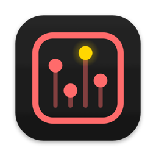
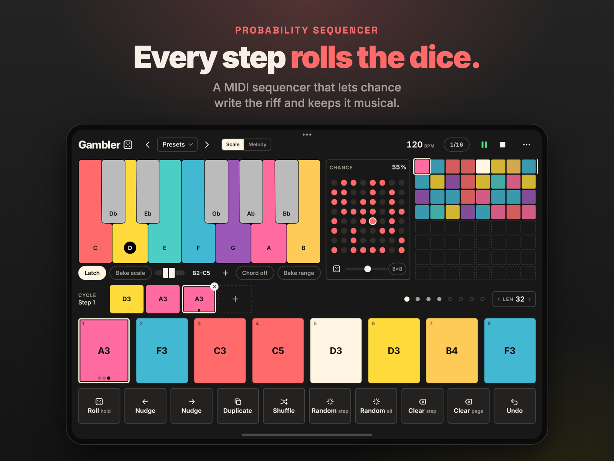
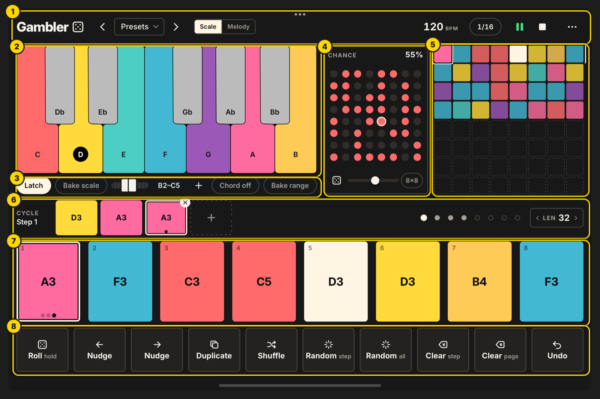
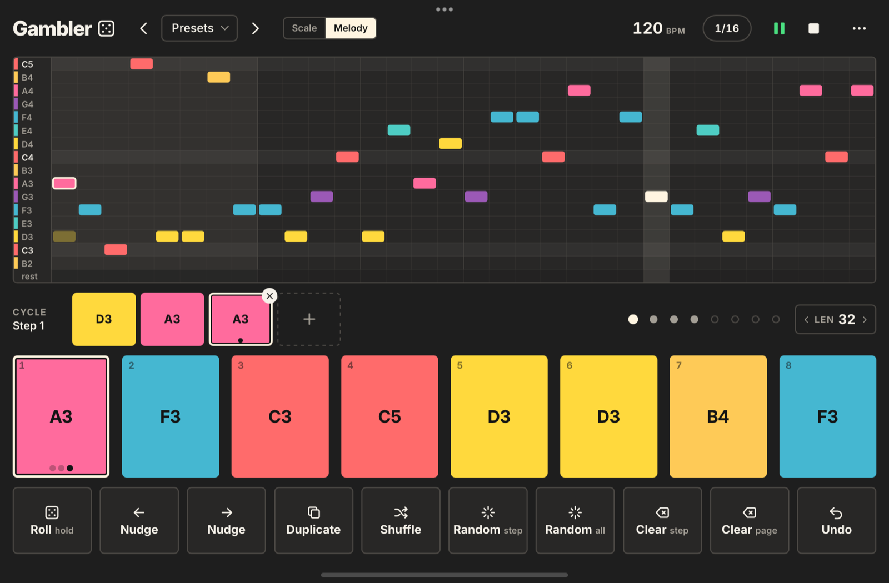

<p align="center">
  
</p>

<h1 align="center">Gambler</h1>

<p align="center">
  <b>A probability-driven MIDI step sequencer that lets chance write the riff and keeps it in key.</b><br>
  Free and open source · iPad (standalone + AUv3) · macOS (standalone, AU, VST3, CLAP)
</p>

<p align="center">
  
</p>

---

## What it does

Gambler is a step sequencer that rolls the dice for you. You set the odds, choose which notes are allowed and how high or low they can go, and Gambler plays MIDI patterns that surprise you but always stay musical.

Gambler makes no sound of its own: it plays your synths. Load it as a MIDI plugin in a host or DAW, or run the standalone app and send MIDI to other apps and hardware.

- **Up to 64 steps**, each holding up to **8 notes** that cycle every time the step comes round
- **Chance grid**: an 8×8 pattern decides how likely each step is to play
- **Roll**: hold it and every step plays a fresh random note from your range
- **Scale lock**: choose any of the 12 notes and up to three note ranges; everything is quantized live
- **Chord input**: play a chord on MIDI input and it becomes the note range
- **Melody view**: see and edit the whole line on a piano roll
- **Clock**: internal, host sync or external MIDI clock
- **MIDI Learn**, **presets**, **undo** and **MIDI file export**

## Using Gambler



| | Area | What it does |
|---|---|---|
| **1** | **Top bar** | Presets (‹ › to step through, tap the name to save or load). **Scale / Melody** switches the upper half. Drag the tempo up or down; **1/16** sets the step size. Play/pause, stop, and **⋯** for *Export MIDI file*, *MIDI learn*, *Settings* and *Report a bug*. |
| **2** | **Scale keys** | The notes Gambler is allowed to play. With **Latch** on, tap a key to add or remove it; with Latch off, a key is only in the scale while you hold it. |
| **3** | **Range & scale tools** | Drag the handles to set the note range; **+** adds up to three ranges. **Chord off / Span / Exact** lets a chord on MIDI input set the range. **Bake scale / Bake range** write the scale or range into the stored notes instead of applying them while playing. |
| **4** | **Chance** | How likely each step is to fire. Drag across the dots to paint them on or off, use the slider to set the overall chance, the dice to scatter a new pattern, and **8×8** to change the pattern size. |
| **5** | **Overview** | All 64 steps at a glance. Tap a row to jump to that page, drag to set the sequence length, double-tap to move the playhead. |
| **6** | **Cycle** | The notes inside the selected step. Each pass of the sequence plays the next one. **+** adds a note (up to 8), ✕ removes one. **LEN** sets the sequence length. |
| **7** | **Steps** | The 8 steps on the current page. Tap to select, drag up or down to change the note, swipe sideways to change page. |
| **8** | **Actions** | **Roll** (hold) plays random notes. **Nudge** rotates the whole sequence one step left or right, **Duplicate** doubles the sequence by copying it onto the end, **Shuffle** mixes the order of the steps, **Random** re-rolls one step or all of them, **Clear** empties the step or page, **Undo** takes it back. |

The **Melody view** shows the same sequence as a piano roll. Drag a note to change it, drag across steps to draw, or drag the note names to scroll.



**Settings** (⋯ → Settings): clock source (Internal / Host / MIDI clock), tempo and step size, MIDI output channel, note length, *Play notes while editing*, *Follow the playhead*, and the note colours.

**MIDI Learn** (⋯ → MIDI learn): tap a control, then move a knob or press a key or pad on your controller to map it.

**Report a bug** (⋯ → Report a bug): opens a GitHub bug report with the app version, device and host already filled in. Inside an AUv3 host, iOS doesn't let plugins open links, so the link is copied instead; paste it into Safari.

### Getting sound out of it

- **On iPad**: add Gambler as a MIDI processor in an AUv3 host that supports MIDI plugins, and route its output to a synth. The standalone app sends MIDI to connected MIDI devices and apps.
- **On macOS**: load the AU, VST3 or CLAP as a MIDI effect in your DAW and route it to an instrument track, or run the standalone app and pick a MIDI output.

---

## Building from source

### Requirements

- macOS with **Xcode 16** or later (for macOS and iOS builds)
- **CMake 3.25+** and **Ninja** (`brew install cmake ninja`)
- Git, with submodules

```bash
git clone --recurse-submodules https://github.com/regulus33/Gambler.git
cd Gambler
# already cloned without submodules?
git submodule update --init --recursive
```

### macOS

```bash
cmake -B build -G Ninja -DCMAKE_BUILD_TYPE=Debug
cmake --build build --target Gambler2_Standalone   # or Gambler2_AU, Gambler2_VST3, Gambler2_CLAP
```

Built plugins are copied to `~/Library/Audio/Plug-Ins/` automatically.

### iPad (standalone + AUv3)

```bash
./build-ios.sh -s          # Debug build for the iOS Simulator
./build-ios.sh -d          # Debug build for a device (needs signing, see below)
./build-ios.sh -r -d       # Release build for a device
./open-xcode.sh            # just generate and open the Xcode project
```

This generates `build-ios/Gambler2.xcodeproj` and opens it in Xcode. Choose the **Gambler2_Standalone** scheme and press Run; installing the app also installs the AUv3 extension.

**Signing:** the development team is set in [`cmake/PamplejuceIOS.cmake`](cmake/PamplejuceIOS.cmake) (`CMAKE_XCODE_ATTRIBUTE_DEVELOPMENT_TEAM`). Put in your own Team ID (or pass `-DCMAKE_XCODE_ATTRIBUTE_DEVELOPMENT_TEAM=XXXXXXXXXX`). Use separate build folders for simulator and device builds, or add `-c` for a clean build when switching.

### Releasing

iPad releases are built, signed and uploaded to App Store Connect by GitHub Actions when a version tag is pushed (`git tag v1.0.1 && git push origin v1.0.1`). See [`docs/RELEASING.md`](docs/RELEASING.md) for the one-time signing setup.

### Tests

```bash
cmake --build build --target Tests
./build/Tests                          # all tests (Catch2)
./build/Tests "[visual]"               # visual snapshot tests only
UPDATE_SNAPSHOTS=1 ./build/Tests "[visual]"   # accept new snapshot goldens
./scripts/pluginval.sh                 # validate the built VST3 with pluginval
```

CI runs the tests on every push and pull request to `main` (`.github/workflows/tests.yml`).

### Working on the UI without a build

The editor is a web page in [`web/`](web/). Open `web/index.html` in a browser and it runs against a mock engine ([`web/js/mock-engine.js`](web/js/mock-engine.js)), so you can work on the UI without compiling the plugin.

---

## How it's put together

```
source/
  PluginProcessor.*   the controller: owns state, clock, MIDI in/out, presets
  backend/            Sequence, Step, SequenceState, Clock, DawSync, ScaleQuantizer, MIDI learn
  algorithms/         the "Eden growth" chance pattern
  bridge/UiBridge.*   the one seam between the engine and the UI (events out, actions in)
  web/WebEditor.*     the plugin window: a WKWebView/WebView2 showing web/
  ui/                 the original JUCE component editor (still built, used by the visual tests)
  data/Params.h       every parameter ID and its range
web/                  the UI: index.html, css/, js/ (app.js, bridge.js, mock-engine.js)
tests/                Catch2 tests, including visual snapshots in tests/snapshots/
packaging/            icons, iOS asset catalog and Info.plist, App Store kit (packaging/appstore/)
```

- The audio thread ticks the sequencer, which writes MIDI into the host's buffer (or a MIDI output in the standalone app).
- State lives in two places on purpose: **APVTS** for small, automatable parameters, and an **InternalState** ValueTree for the large per-step data.
- The UI talks to the engine through a small JSON message contract documented at the top of [`web/js/bridge.js`](web/js/bridge.js).
- The web files are compiled into the binary (`cmake/Assets.cmake`). Their directories are flattened, so file names under `web/` must be unique.

Read [`docs/ARCHITECTURE.md`](docs/ARCHITECTURE.md) for the full tour: threading, information flow, the clock, and the gotchas.

## Contributing

Issues and pull requests are welcome. Found a bug? Use **⋯ → Report a bug** in the app, or [open an issue](https://github.com/regulus33/Gambler/issues/new?template=bug_report.yml).

1. Fork the repo and create a branch.
2. Make your change and add or update tests in `tests/` where it makes sense.
3. Run `./build/Tests` and make sure everything passes. Optionally run `git config core.hooksPath scripts/git-hooks` once: pushes to `main` then build and run the tests first and refuse to send signing files or keys.
4. Open a pull request against `main` describing what changed and why.

Code style is set by [`.clang-format`](.clang-format).

## Credits & license

- Gambler is released under the [MIT License](LICENSE).
- Built with [JUCE](https://juce.com), starting from the [Pamplejuce](https://github.com/sudara/pamplejuce) template. JUCE is not covered by Gambler's MIT license: the official App Store builds use JUCE under its Starter licence, and if you distribute your own builds you need your own JUCE licence (AGPLv3, or a free/paid commercial tier).
- Uses [clap-juce-extensions](https://github.com/free-audio/clap-juce-extensions), [melatonin_inspector](https://github.com/sudara/melatonin_inspector) and [Catch2](https://github.com/catchorg/Catch2).
- Font: [Inter](https://rsms.me/inter/) by Rasmus Andersson, [SIL Open Font License](web/fonts/OFL.txt).
