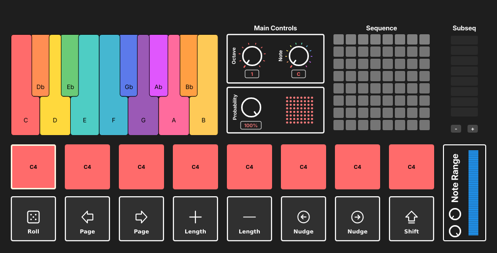
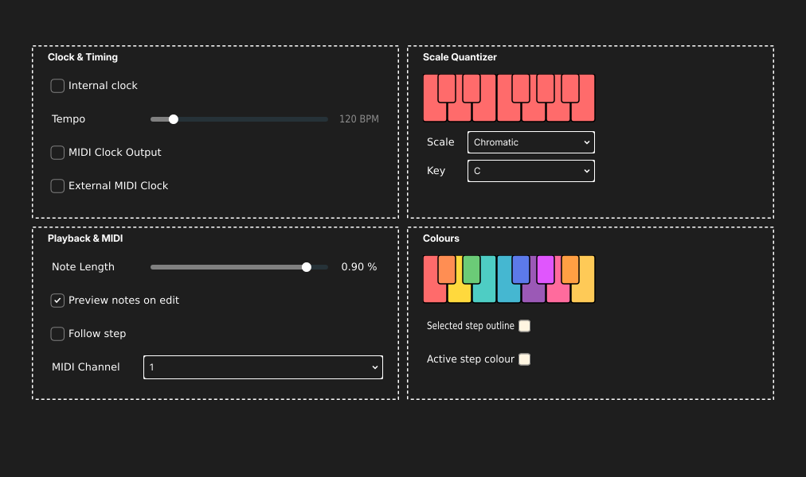
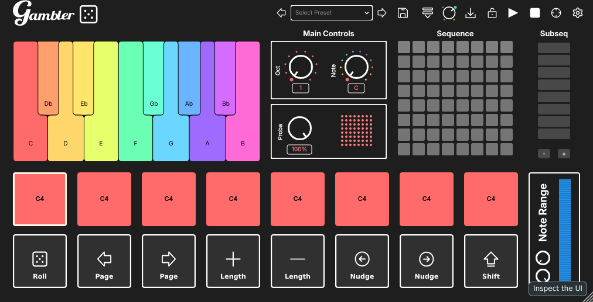
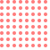
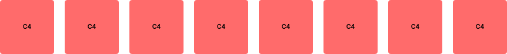
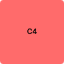
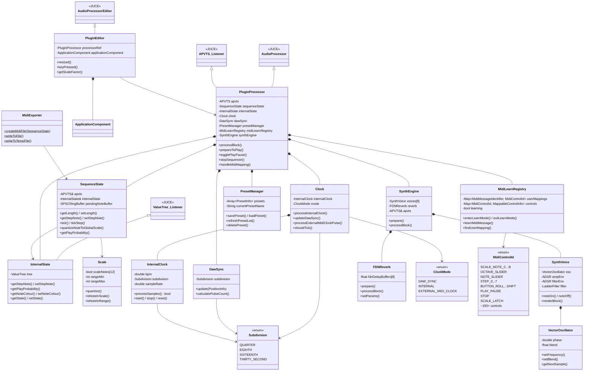

# Gambler2

A JUCE-based MIDI step sequencer plugin with probabilistic note generation, scale quantization, and per-step substep editing.

**Formats:** Standalone, AU, VST3, AUv3, CLAP
**Company:** ToneGarden

## Build

```bash
cmake -B build && cmake --build build                          # full build
cmake --build build --target Gambler2_Standalone                # standalone only
cmake --build build --target Tests && ./build/Tests             # run all tests
UPDATE_SNAPSHOTS=1 ./build/Tests "[visual]"                    # update visual goldens
```

Requires C++23, JUCE 8.0.x, ninja.

### pluginval (plugin validation)

[pluginval](https://github.com/Tracktion/pluginval) runs automated tests against the built VST3 to check for crashes, parameter handling issues, state save/restore correctness, and more.

```bash
# Build the plugin first, then run pluginval (downloads automatically on first run)
cmake -B build && cmake --build build
./scripts/pluginval.sh                        # default strictness level 5
./scripts/pluginval.sh --strictness-level 10  # maximum strictness
```

Strictness levels range from 1 (basic scan) to 10 (exhaustive stress tests). Level 5 is a good default for development; level 10 is recommended before release.

---

## UI Component Inventory

### Component Hierarchy

```
ApplicationComponent
├─ MainScreenComponent
│  ├─ NavBarComponent
│  │  ├─ PresetSelectorComponent
│  │  │  ├─ StyledDropdown
│  │  │  └─ PresetCycleButton (×2)
│  │  ├─ LogoComponent
│  │  ├─ ToggleIconButton (×6: MIDI Learn, Settings, Play/Pause, Stop, Compact, Swap)
│  │  ├─ ScaleLatchButton
│  │  ├─ ExportButton
│  │  └─ SubdivisionSlider
│  ├─ PianoRollComponent
│  ├─ MainControlsComponent
│  │  ├─ NoteControlsComponent
│  │  │  ├─ OctaveSlider (NotchedSlider)
│  │  │  └─ NoteSlider (NotchedSlider)
│  │  └─ ProbabilityControlsComponent
│  │     ├─ AnalogueSlider (ProbabilitySlider)
│  │     └─ ProbabilityGauge
│  ├─ SequenceOverviewComponent
│  │  └─ SequenceGrid
│  ├─ SequencerStepsComponent
│  │  └─ StepButton (×8)
│  ├─ SequencerControlsComponent
│  │  ├─ RollButton
│  │  ├─ ShiftButton
│  │  ├─ Normal mode: PageLeft, PageRight, Length+, Length−, NudgeLeft, NudgeRight
│  │  └─ Shift mode:  Duplicate, ClearWindow, ClearStep, RandAll, RandStep, Shuffle
│  ├─ SubsequenceControlsComponent
│  │  ├─ SubsequenceBar → SingleBar (×8)
│  │  └─ SubsequenceButton (−/+)
│  └─ NoteRangeControlsComponent
│     ├─ NoteRangeGauge
│     └─ Slider (offset/size)
│
└─ SettingsScreenComponent
   ├─ NavBarComponent (shared)
   ├─ SettingsGroup "Clock & Timing" (internal clock, tempo, MIDI clock output, external MIDI clock)
   ├─ SettingsGroup "Scale Quantizer" → GlobalScaleQuantizerComponent
   ├─ SettingsGroup "Playback & MIDI" (note length, preview notes, follow step, MIDI output channel)
   └─ SettingsGroup "Colours" → NoteColourPickerComponent + step colour swatches
```

### Main Screens

| Component | File | Snapshot | Description |
|-----------|------|----------|-------------|
| ApplicationComponent | `source/ui/ApplicationComponent.h` |  | Top-level orchestrator; swaps between main and settings screens |
| MainScreenComponent | `source/ui/MainScreenComponent.h` |  | Primary sequencer workspace with all controls |
| SettingsScreenComponent | `source/ui/SettingsScreenComponent.h` |  | Full-screen settings (Clock, Playback, MIDI config) |
| PluginEditor | `source/PluginEditor.h` |  | JUCE editor wrapper; handles keyboard input and responsive scaling |

### Navigation Bar

| Component | File | Snapshot | Description |
|-----------|------|----------|-------------|
| NavBarComponent | `source/ui/NavBarComponent/NavBarComponent.h` |  | Top bar with preset selector, transport, tools, settings |
| LogoComponent | `source/ui/LogoComponent.h` |  | "Gambler" text logo with dice icon |
| PresetSelectorComponent | `source/ui/PresetSelectorComponent.h` |  | StyledDropdown + cycle buttons for preset navigation |
| SavePresetDialogComponent | `source/ui/SavePresetDialogComponent.h` |  | Modal dialog for saving presets |
| ExportButton | `source/ui/NavBarComponent/NavBarComponent.h` | — | Click-to-save or drag-to-DAW MIDI export |
| ScaleLatchButton | `source/ui/ScaleLatchButton.h` |  | Toggle momentary/latched scale editing |
| SubdivisionSlider | `source/ui/sliders/SubdivisionSlider.h` |  | Clock division selector (1/4, 1/8, 1/16, 1/32) |
| ToggleIconButton | `source/ui/ToggleIconButton.h` |  | Generic two-state icon button (used for Settings, Play, Stop, etc.) |
| StyledDropdown | `source/ui/StyledDropdown.h` |  | Unified dropdown component with animated chevron and click flash |

### Piano Roll & Scale

| Component | File | Snapshot | Description |
|-----------|------|----------|-------------|
| PianoRollComponent | `source/ui/PianoRollComponent/PianoRollComponent.h` |  | 12-key chromatic keyboard for global scale selection |
| GlobalScaleQuantizerComponent | `source/ui/GlobalScaleQuantizerComponent.h` |  | Scale type dropdown + preset scale buttons (settings) |
| NoteColourPickerComponent | `source/ui/NoteColourPickerComponent.h` |  | Per-note colour customization (settings) |

### Main Controls

| Component | File | Snapshot | Description |
|-----------|------|----------|-------------|
| MainControlsComponent | `source/ui/MainControlsComponent.h` |  | Container for note/octave + probability controls |
| NoteControlsComponent | `source/ui/NoteControlsComponent.h` |  | Bordered panel with OctaveSlider + NoteSlider |
| OctaveSlider | `source/ui/sliders/OctaveSlider.h` | — | Discrete rotary for octave (0-9) |
| NoteSlider | `source/ui/sliders/NoteSlider.h` | — | Discrete rotary for pitch class (C-B), scale-filtered |
| NotchedSlider | `source/ui/sliders/NotchedSlider.h` | — | Base discrete rotary with colored dot notches |
| ProbabilityControlsComponent | `source/ui/ProbabilityControlsComponent.h` |  | Probability slider + visual gauge |
| AnalogueSlider | `source/ui/sliders/ProbabilitySlider.h` | — | Continuous rotary for probability (0-100%) |
| ProbabilityGauge | `source/ui/ProbabilityGauge.h` |  | 8×8 grid visualizing random probability distribution |

### Sequencer

| Component | File | Snapshot | Description |
|-----------|------|----------|-------------|
| SequencerStepsComponent | `source/ui/SequencerStepsComponent.h` |  | 8 visible steps (window into 64-step sequence) |
| StepButton | `source/ui/buttons/StepButton.h` |  | Individual step: shows note name, selection state, playhead |
| SequencerControlsComponent | `source/ui/SequencerControlsComponent.h` |  | 8-button row with normal/shift modes |
| SequenceOverviewComponent | `source/ui/SequenceOverviewComponent.h` |  | 8×8 grid overview of entire 64-step sequence |
| SequenceGrid | `source/ui/SequenceGrid/SequenceGrid.h` |  | Clickable grid for navigation and length adjustment |

### Sequencer Control Buttons

All inherit from `SequencerControlButton` (`source/ui/buttons/SequencerControlButton.h`).

**Normal Mode (Shift OFF):**

| Pos | Button | File | APVTS Param | Function |
|-----|--------|------|-------------|----------|
| 0 | RollButton | `buttons/RollButton.h` | SEQ_IS_RANDOM | Momentary random mode |
| 1 | PageLeftButton | `buttons/PageLeftButton.h` | INDEX_LEFT | Page window left 8 steps |
| 2 | PageRightButton | `buttons/PageRightButton.h` | INDEX_RIGHT | Page window right 8 steps |
| 3 | LengthPlusButton | `buttons/LengthPlusButton.h` | LENGTH_PLUS | Increase sequence length |
| 4 | LengthMinusButton | `buttons/LengthMinusButton.h` | LENGTH_MINUS | Decrease sequence length |
| 5 | NudgeLeftButton | `buttons/NudgeLeftButton.h` | NUDGE_LEFT | Shift all notes left |
| 6 | NudgeRightButton | `buttons/NudgeRightButton.h` | NUDGE_RIGHT | Shift all notes right |
| 7 | ShiftButton | `buttons/ShiftButton.h` | SEQ_IS_SHIFT | Toggle shift mode |

**Shift Mode (Shift ON) — buttons 1-6 swap:**

| Pos | Button | File | APVTS Param | Function |
|-----|--------|------|-------------|----------|
| 1 | DuplicateButton | `buttons/DuplicateButton.h` | DUPLICATE | Double length + copy |
| 2 | ClearWindowButton | `buttons/ClearWindowButton.h` | CLEAR_WINDOW | Clear visible 8 steps |
| 3 | ClearStepButton | `buttons/ClearStepButton.h` | CLEAR_STEP | Clear selected step |
| 4 | RandomizeAllButton | `buttons/RandomizeAllButton.h` | RANDOMIZE_ALL | Randomize all steps |
| 5 | RandomizeStepButton | `buttons/RandomizeStepButton.h` | RANDOMIZE_STEP | Randomize current step |
| 6 | ShuffleButton | `buttons/ShuffleButton.h` | SHUFFLE | Shuffle step order |

Shift-mode buttons share MIDI mappings with their normal-mode counterparts.

### Subsequence & Note Range

| Component | File | Snapshot | Description |
|-----------|------|----------|-------------|
| SubsequenceControlsComponent | `source/ui/SubsequenceControlsComponent.h` |  | Per-step substep editing (up to 8 variations) |
| NoteRangeControlsComponent | `source/ui/NoteRangeControlsComponent.h` |  | MIDI note range window (offset + size sliders + gauge) |

### Settings

| Component | File | Snapshot | Description |
|-----------|------|----------|-------------|
| SettingsGroup | `source/ui/SettingsGroup.h` |  | Reusable titled container for grouped settings |

### Base Classes & Utilities

| Class | File | Description |
|-------|------|-------------|
| StateListenerComponent | `source/ui/StateListenerComponent.h` | Base for all APVTS-observing components (thread-safe async updates) |
| ClickFlash | `source/ui/ClickFlashMixin.h` | Self-contained click feedback animation (gold flash, VBlank-driven) |
| Icons | `source/ui/Icons.h` | Centralized SVG path factory for all icons |
| UIConstants | `source/ui/UIConstants.h` | Global colour constants |
| MusicConstants | `source/ui/MusicConstants.h` | Note names, colours, octave labels |
| MidiLearnOverlayPainter | `source/ui/MidiLearnOverlayPainter.h` | Blue overlay drawn during MIDI learn mode |

---

## Animation Deep Dive

This section explains how UI animation works in this project. If you come from a web or game-engine background where you declare animations ("transition this property over 300ms"), things work differently here. In JUCE, there are no CSS transitions, no animation timeline objects, no declarative keyframes. Every pixel is drawn manually in a `paint()` method, and "animation" means changing what you draw on each frame.

### The Core Idea

Every JUCE component has a `paint(Graphics& g)` method that the framework calls whenever the component needs to be redrawn. Inside `paint()`, you use the `Graphics` object to draw shapes, text, and images — procedurally, line by line. There is no retained scene graph. If you want a blue rectangle, you write:

```cpp
g.setColour(juce::Colours::blue);
g.fillRoundedRectangle(bounds, 4.0f);
```

To "animate" means: each time `paint()` is called, draw something slightly different from last time — a colour a bit closer to its target, an angle rotated a bit further, an alpha faded down a bit more. Between frames, you need a timing mechanism to trigger repaints. That mechanism is **VBlankAttachment**.

### VBlankAttachment: The Animation Clock

`juce::VBlankAttachment` hooks into the display's vertical blank signal — the moment the monitor finishes drawing one frame and is ready for the next. This gives you a callback synchronized to the actual screen refresh rate (typically 60Hz, but adapts to 120Hz displays, etc.). It replaces the older `Timer`-based approach which ran on a fixed interval regardless of display timing.

Setting one up looks like this:

```cpp
void parentHierarchyChanged() override {
    if (getTopLevelComponent() != nullptr && vBlankAttachment_ == nullptr) {
        vBlankAttachment_ = std::make_unique<juce::VBlankAttachment>(
            this, [this](double timestampSec) {
                // Calculate how much real time elapsed since last frame
                double delta = (lastVBlankTimestamp_ > 0.0)
                    ? (timestampSec - lastVBlankTimestamp_)
                    : (1.0 / 60.0);  // safe default for first call
                lastVBlankTimestamp_ = timestampSec;

                // Clamp to avoid huge jumps if the app was suspended
                frameDeltaSec_ = static_cast<float>(juce::jlimit(0.001, 0.1, delta));

                // Only repaint if an animation is actively running
                if (needsAnimationRepaint_) {
                    needsAnimationRepaint_ = false;
                    repaint();
                }
            });
    }
}
```

Key points:

- **Lazy initialization**: The attachment is created in `parentHierarchyChanged()`, which fires when the component is added to a visible window. This avoids wasting resources on components that haven't been displayed yet.
- **Delta time**: The callback receives a timestamp. By subtracting the previous timestamp, you get the real elapsed time between frames (`frameDeltaSec_`). This makes animation speed independent of the display's refresh rate.
- **Clamping**: `jlimit(0.001, 0.1, delta)` prevents two problems — division-by-near-zero on very fast callbacks, and massive jumps if the app was backgrounded for seconds.
- **Flag-based repainting**: The `needsAnimationRepaint_` flag ensures `repaint()` is only called when an animation is actually in progress. Once the animation converges, the flag stays false and no CPU is wasted.

### Animation Types Used in This Project

| Type | Mechanism | Duration | Used By |
|------|-----------|----------|---------|
| **Colour fade** | Lerp toward target colour each frame | ~125ms (speed=8) | StepButton, SequencerControlButton, PianoRollComponent, SequenceGrid |
| **Click flash** | Alpha fades from 1.0 → 0.0 | 300ms | ClickFlash mixin (ToggleIconButton, StyledDropdown, ExportButton) |
| **Pulse glow** | Sinusoidal oscillation between two colours | 2.5s cycle | ToggleIconButton (hint mode) |
| **Chevron rotation** | Angle interpolation toward target | ~200ms (spring=12) | StyledDropdown |

### Complete Walkthrough: StepButton Colour Animation

`StepButton` (`source/ui/buttons/StepButton.h`) is the best example of how painting and animation interact in this codebase. Each StepButton represents one of 8 visible sequencer steps and smoothly transitions its background colour between states — white when the playhead is on it, a note colour when it holds a note, grey when it's a rest.

#### The State That Drives the Animation

StepButton extends `StateListenerComponent`, which provides thread-safe observation of the plugin's parameter state (APVTS). In the constructor, it subscribes to changes:

```cpp
StepButton(PluginProcessor& processor, int localIndex)
    : StateListenerComponent(processor), localIndex_(localIndex)
{
    listenToStepNotes(0, 63);        // all 64 step note values
    listenToStepNotesLength(0, 63);  // all 64 step lengths
    listenToSequenceMetadata();       // playhead position, selected step, etc.

    for (int i = 0; i < 12; ++i)
        listenToParameter(Params::Keys::ID::noteColour(i));  // per-note colours
}
```

When any of these parameters change (from any thread — the audio thread, the UI thread, a MIDI message), `StateListenerComponent` coalesces the notifications and calls `onStateChanged()` on the message thread:

```cpp
void onStateChanged() override {
    repaint();  // schedule a redraw
}
```

#### The Animation Members

```cpp
juce::Colour displayColour_ { StepButtonConstants::emptyStepColor };  // what we're currently showing
bool displayColourInitialised_ = false;   // snap to target on first paint (no fade from black)
bool needsAnimationRepaint_ = false;      // "keep calling paint() next frame"
float frameDeltaSec_ = 1.0f / 60.0f;      // time since last VBlank
double lastVBlankTimestamp_ = 0.0;         // previous VBlank timestamp
std::unique_ptr<juce::VBlankAttachment> vBlankAttachment_;
```

`displayColour_` is the key: it's the colour the button is *actually drawn with right now*, as opposed to the colour it *should be* (the target). The animation is the process of `displayColour_` chasing the target.

#### How paint() Works, Step by Step

```cpp
void paint(juce::Graphics& g) override {
    auto& state = getState();
    int absoluteStepIndex = getAbsoluteStepIndex();
```

**Step 1 — Determine the target colour.** This is pure state logic, no animation yet:

```cpp
    juce::Colour targetColor;

    if (isCurrent) {
        targetColor = UIConstants::activeStepColour;          // white — playhead is here
    } else if (isRest) {
        targetColor = StepButtonConstants::restStepColor;     // grey — this step is silent
    } else {
        int chromaticNote = midiNote % 12;
        targetColor = getState().getNoteColour(chromaticNote); // note colour (e.g., coral for C)
    }
```

**Step 2 — Animate toward the target.** On the very first paint, snap instantly (don't fade up from black). After that, lerp:

```cpp
    if (!displayColourInitialised_) {
        displayColour_ = targetColor;           // first frame: instant
        displayColourInitialised_ = true;
    } else if (displayColour_ != targetColor) {
        float t = juce::jmin(1.0f, colourFadeSpeed * frameDeltaSec_);
        displayColour_ = displayColour_.interpolatedWith(targetColor, t);

        if (displayColour_ != targetColor)
            needsAnimationRepaint_ = true;      // not converged yet — keep going
    }
```

The lerp formula `interpolatedWith(target, t)` blends each RGBA channel: `current + (target - current) * t`. With `colourFadeSpeed = 8.0f` and a 60fps display (`frameDeltaSec_ ≈ 0.0167`), `t ≈ 0.13` each frame — meaning the colour covers about 13% of the remaining distance per frame. This creates an exponential ease-out: fast at first, then gradually settling. After roughly 8 frames (~125ms) the colour is perceptually indistinguishable from the target.

**Step 3 — Draw with the animated colour:**

```cpp
    g.setColour(displayColour_);
    g.fillRoundedRectangle(bounds, cornerRadius);
```

**Step 4 — Draw the static parts** (selection border, note text, active circle) on top of the animated background. These don't animate — they appear or disappear immediately based on state:

```cpp
    if (isSelected) {
        g.setColour(UIConstants::selectedStepOutlineColour);
        g.drawRoundedRectangle(borderBounds, borderRadiusInner, borderWidthSelected);
    }

    if (!isRest)
        drawNoteText(g, bounds, midiNote, isCurrent);

    if (isCurrent && !isRest)
        drawActiveCircle(g, bounds, midiNote);
```

#### The Animation Loop

Here's the full cycle as a diagram:

```
State change (any thread)
    │
    ▼
StateListenerComponent coalesces → onStateChanged() on message thread
    │
    ▼
repaint() scheduled ──────────────────────────────────┐
    │                                                  │
    ▼                                                  │
paint() called                                         │
    │  ├─ compute targetColor from state               │
    │  ├─ lerp displayColour_ toward target            │
    │  ├─ if not converged: needsAnimationRepaint_=true│
    │  └─ draw with displayColour_                     │
    │                                                  │
    ▼                                                  │
VBlank fires                                           │
    │  ├─ compute frameDeltaSec_                       │
    │  └─ if needsAnimationRepaint_: repaint() ────────┘
    │
    (loop continues until displayColour_ == targetColor)
```

Once the colours match, `needsAnimationRepaint_` stays false, the VBlank callback becomes a no-op, and the component is fully idle — no CPU spent until the next state change.

#### Why This Pattern Works Well

- **Framerate-independent**: A 120Hz display will run twice as many frames with half the `frameDeltaSec_`, producing the same visual speed.
- **Self-stopping**: The convergence check means components don't burn CPU when static. In a 64-step sequencer where only 1-2 steps are animating at a time, the other 62 are idle.
- **No separate update loop**: The animation computation lives inside `paint()` itself. There is no separate "update" pass followed by a "render" pass — the two are fused. This is simpler than a game-engine-style update/draw split, at the cost of coupling rendering to animation logic.
- **Thread-safe**: State changes from the audio thread are marshalled to the message thread by `StateListenerComponent` before `paint()` ever reads them. The animation state (`displayColour_`, `needsAnimationRepaint_`) is only ever touched on the message thread.

#### ClickFlash: A Simpler Animation Example

For contrast, `ClickFlash` (`source/ui/ClickFlashMixin.h`) shows the same VBlank pattern applied to a simpler case — a gold overlay that appears on click and fades out:

```cpp
void trigger() {
    alpha_ = 1.0f;       // start fully visible
    active_ = true;
    ensureVBlank();       // create VBlankAttachment if needed
}

void onVBlank(double timestampSec) {
    if (!active_) return;
    // ... compute dt ...
    alpha_ -= dt / fadeDuration_;  // linear fade over 300ms
    if (alpha_ <= 0.0f) {
        alpha_ = 0.0f;
        active_ = false;          // done — stop animating
    }
    owner_->repaint();
}

void paint(juce::Graphics& g, juce::Rectangle<int> bounds) const {
    if (alpha_ <= 0.0f) return;
    g.setColour(colour_.withAlpha(alpha_ * maxAlpha_));
    g.fillRoundedRectangle(bounds.toFloat(), r);
}
```

The structure is identical to StepButton's colour fade: an animated property (`alpha_`), a VBlank callback that updates it and calls `repaint()`, and a `paint()` method that draws with the current animated value. The only difference is that `alpha_` uses linear decay (`-= dt / duration`) instead of exponential lerp.

---

## Backend Class Diagram



---


---

## Tests

```bash
cmake -B build && cmake --build build --target Tests && ./build/Tests
```

Visual snapshot tests live in `tests/VisualSnapshotTests.cpp`. Golden images are in `tests/snapshots/`.


#### Docs

See [`DOCS.md`](DOCS.md) for the architecture, information flow, and developer guide.


#### Tests API

```
The TestApp API looks like:                                                                                                             
                                                   
  TestApp app;                                                                                                                            
                                                                                                                                          
  // Transport                                 
  app.navBar().clickPlayPause();                                                                                                          
  app.navBar().clickStop();                        
                                               
  // Sequencer controls (buttons via mouse simulation)                                                                                    
  app.sequencerControls().rollButton().press();   // hold
  app.sequencerControls().rollButton().release();  // release                                                                             
  app.sequencerControls().shiftButton().click();                                                                                          
  app.sequencerControls().lengthPlusButton().click();
  app.sequencerControls().pageRightButton().click();                                                                                      
                                                   
  // Piano roll                                                                                                                           
  app.pianoRoll().toggleNote(1);  // toggle Db     
                                                                                                                                          
  // Subsequence                                   
  app.subsequenceControls().clickPlus();                                                                                                  
  app.subsequenceControls().clickBar(2);                                                                                                  
                                               
  // Grid navigation                                                                                                                      
  app.sequenceOverview().clickStep(12);            
  app.sequenceOverview().doubleClickStep(10);                                                                                             
                                                   
  // State & audio                                                                                                                        
  app.state()            // SequenceState&
  app.processor()        // PluginProcessor&                                                                                              
  app.processMessages(); // pump JUCE message loop                                                                                        
  app.simulateAudioBlock();                    
                                                                                                                                          
  ```


