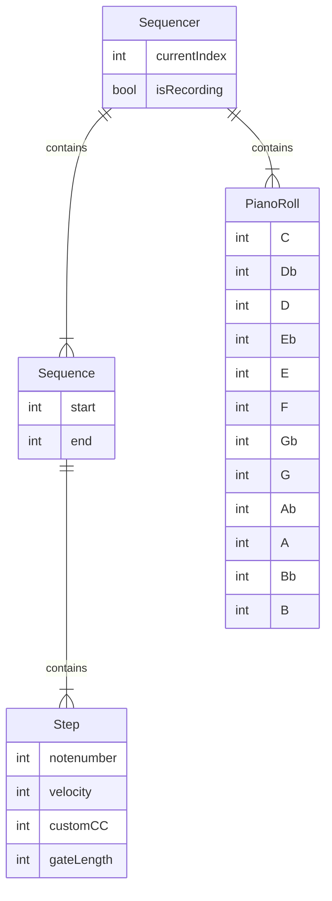

# Gambler

## AudioProcessorValueTreeState Parameters

The following parameters are created in the APVTS (see source/data/Params.h). Patterns in braces indicate one parameter
per step, for i = 0..127.

- Total parameter count: 514 (2 global + 4 × 128 per-step)

| ID Pattern        | Label Pattern     | Type  | Range      | Default | Notes                                                |
|-------------------|-------------------|-------|------------|---------|------------------------------------------------------|
| STEP_LENGTH       | Step Length       | Int   | 1..128     | 16      | Global sequencer length (number of steps considered) |
| STEP_INDEX        | Current Step      | Int   | 0..127     | 0       | Global current step index                            |
| STEP_{i}_ACTIVE   | Step {i} Active   | Bool  | false/true | false   | Per-step trigger/active flag                         |
| STEP_{i}_NOTE     | Step {i} Note     | Int   | 0..127     | i       | MIDI note number for step i                          |
| STEP_{i}_VELOCITY | Step {i} Velocity | Int   | 1..127     | 100     | MIDI velocity for step i                             |
| STEP_{i}_GATE     | Step {i} Gate     | Float | 0.0..1.0   | 0.75    | Fraction of step duration to hold                    |

Examples of concrete IDs:

- STEP_0_ACTIVE, STEP_0_NOTE, STEP_0_VELOCITY, STEP_0_GATE
- STEP_127_ACTIVE, STEP_127_NOTE, STEP_127_VELOCITY, STEP_127_GATE
