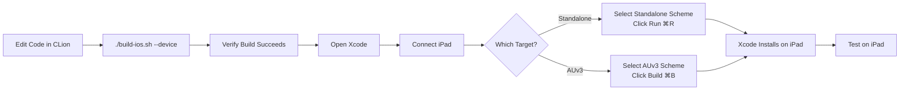

# CLion iOS Development Setup

This guide covers setting up CLion for iOS development with Gambler.




## CLion Configuration

### Adding iOS CMake Profile

1. Open CLion Settings (⌘,)
2. Go to Build, Execution, Deployment → CMake
3. Click the "+" button to add a new profile
4. Configure as follows:

**For iOS Simulator:**
```
Name: iOS-Simulator-Debug
Build type: Debug
CMake options: -GXcode -DCMAKE_SYSTEM_NAME=iOS -DCMAKE_OSX_DEPLOYMENT_TARGET=12.0 -DCMAKE_OSX_SYSROOT=iphonesimulator
Build directory: build-ios-sim
```

**For iOS Device:**
```
Name: iOS-Device-Debug
Build type: Debug
CMake options: -GXcode -DCMAKE_SYSTEM_NAME=iOS -DCMAKE_OSX_DEPLOYMENT_TARGET=12.0 -DCMAKE_OSX_SYSROOT=iphoneos
Build directory: build-ios-device
```

**For iOS Device Release:**
```
Name: iOS-Device-Release
Build type: Release
CMake options: -GXcode -DCMAKE_SYSTEM_NAME=iOS -DCMAKE_OSX_DEPLOYMENT_TARGET=12.0 -DCMAKE_OSX_SYSROOT=iphoneos
Build directory: build-ios-release
```

5. Click "OK" to save

### Building from CLion

1. Select the iOS profile from the profile dropdown (top-right)
2. Wait for CMake to finish configuring
3. Select target: `Gambler2_Standalone` or `Gambler2_AUv3`
4. Click the hammer icon to build

**Note**: CLion cannot directly run iOS apps. After building, you'll need to:
- Use the build script: `./build-ios.sh`
- Or open in Xcode: `open build-ios-sim/Gambler2.xcodeproj`

## Recommended Workflow

### Development Cycle

1. **Edit code in CLion** - Use CLion's excellent C++ editing features
2. **Build via script** - Run `./build-ios.sh` to build and verify
3. **Test in Xcode** - Open Xcode project to run on simulator/device
4. **Debug in Xcode** - Use Xcode's debugger for iOS-specific issues

### Quick Commands

Add these as External Tools in CLion (Settings → Tools → External Tools):

**Build iOS Simulator:**
```
Program: $ProjectFileDir$/build-ios.sh
Arguments: --simulator
Working directory: $ProjectFileDir$
```

**Build iOS Device:**
```
Program: $ProjectFileDir$/build-ios.sh
Arguments: --device
Working directory: $ProjectFileDir$
```

**Open in Xcode:**
```
Program: /usr/bin/open
Arguments: build-ios/Gambler2.xcodeproj
Working directory: $ProjectFileDir$
```

## Troubleshooting

### "Cannot find Xcode generator"

CLion's bundled CMake might not find Xcode. Solutions:

1. Use the build script (recommended)
2. Install CMake via Homebrew and configure CLion to use it:
   ```bash
   brew install cmake
   ```
   Then in CLion Settings → Build, Execution, Deployment → Toolchains:
   - Set CMake to `/opt/homebrew/bin/cmake` (Apple Silicon) or `/usr/local/bin/cmake` (Intel)

### "iOS SDK not found"

Ensure Xcode Command Line Tools are installed:
```bash
xcode-select --install
```

### CMake configuration fails

1. Check that Xcode is installed and up to date
2. Verify Xcode Command Line Tools: `xcode-select -p`
3. Try cleaning CMake cache: Tools → CMake → Reset Cache and Reload Project

## Tips

### Code Completion

CLion's code completion works best with the macOS profile. For iOS-specific code:

1. Keep a macOS profile active for editing
2. Use conditional compilation for iOS-specific code:
   ```cpp
   #if JUCE_IOS
       // iOS-specific code
   #endif
   ```

### Multiple Profiles

You can have multiple profiles active simultaneously:
- macOS-Debug (for editing and quick testing)
- iOS-Simulator-Debug (for iOS builds)
- iOS-Device-Release (for release builds)

Switch between them as needed.

### Git Integration

The iOS build directories are already in `.gitignore`:
- `build-ios/`
- `build-ios-sim/`
- `build-ios-device/`
- `build-ios-release/`

## Advanced: Custom Build Configurations

If you need custom build configurations, edit `cmake/PamplejuceIOS.cmake`:

```cmake
# Example: Enable bitcode for older iOS versions
if (CMAKE_SYSTEM_NAME STREQUAL "iOS")
    set(CMAKE_XCODE_ATTRIBUTE_ENABLE_BITCODE "YES")
endif()
```

Or pass via CMake options:
```
-DCMAKE_XCODE_ATTRIBUTE_ENABLE_BITCODE=YES
```

## Debugging

### Console Logs

To view console output from iOS devices:

1. Connect device via USB
2. Open Console.app (macOS)
3. Select your device
4. Filter by "Gambler" to see your app's logs

### Xcode Debugger

For serious debugging, use Xcode:

1. Build in CLion (or via script)
2. Open Xcode project
3. Set breakpoints
4. Run on device/simulator
5. Use Xcode's debugger, Instruments, etc.

## Performance Profiling

Use Xcode's Instruments for iOS performance profiling:

1. Build Release configuration
2. Open in Xcode
3. Product → Profile (⌘I)
4. Choose instrument (Time Profiler, Allocations, etc.)

## See Also

- [iOS Build Guide](iOS-Build-Guide.md) - Comprehensive iOS build documentation
- [JUCE CMake API](../JUCE/docs/CMake%20API.md) - Official JUCE CMake documentation
